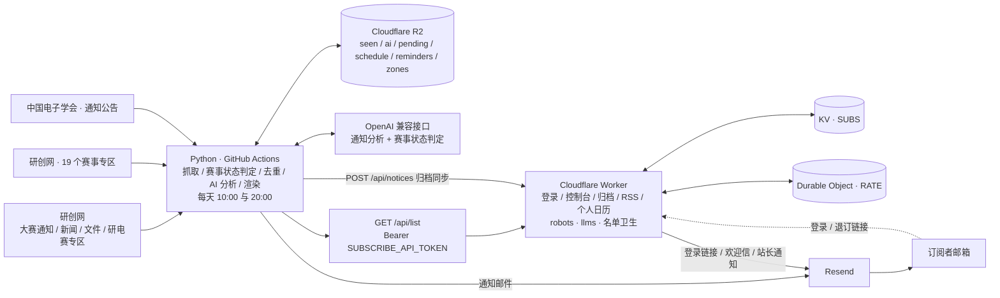

<a id="readme-top"></a>

# 研电赛通知订阅器

[![通知推送][notify-shield]][notify-url]
[![Worker 校验][ci-shield]][ci-url]
[![Cloudflare Workers][cf-shield]][cf-url]
[![Python 3.11+][py-shield]][py-url]
[![TypeScript 5][ts-shield]][ts-url]
[![运行状态][live-shield]][live-url]

> 自动汇总中国研究生创新实践系列大赛的官方通知，按订阅偏好合并成一封邮件推送。
> 抓取与发信跑在 GitHub Actions，订阅中心跑在 Cloudflare Workers，日常运行落在各家免费额度内。

**在线服务**：[https://notice.yds.meovo.cc][live-url] · **仓库**：[ikaraseay/yds-notifier][repo-url]

<details>
<summary><strong>目录</strong></summary>

<ol>
  <li><a href="#about">项目简介</a></li>
  <li><a href="#built-with">技术栈</a></li>
  <li><a href="#architecture">系统架构</a></li>
  <li><a href="#endpoints">在线服务与接口</a></li>
  <li><a href="#account">订阅与邮件</a></li>
  <li><a href="#getting-started">快速开始</a></li>
  <li><a href="#deployment">生产部署</a></li>
  <li><a href="#configuration">配置说明</a></li>
  <li><a href="#security">安全设计</a></li>
  <li><a href="#maintenance">运维与自定义</a></li>
  <li><a href="#faq">常见问题</a></li>
  <li><a href="#contributing">贡献指南</a></li>
  <li><a href="#disclaimer">数据来源与免责声明</a></li>
  <li><a href="#license">许可证</a></li>
</ol>

</details>

<p align="right">(<a href="#readme-top">返回顶部</a>)</p>

---

<a id="about"></a>

## 项目简介

赛事通知分散在多个主办方栏目与各赛事独立专区，人工刷新容易错过报名、评审与决赛节点。本项目把这件事自动化：

- **每天两轮，北京时间 10:00 与 20:00**（`cron: "0 2,12 * * *"` UTC）由 GitHub Actions 抓取列表页并与 `seen.json` 的稳定 UID 比对；只有新条目才请求详情页补摘要与附件。上午轮扫全部数据源并负责日报，晚上轮只扫更新活跃的源；
- **AI 每 14 天批量判定 19 项赛事本年度赛程是否结束**：进行中的每轮扫，已结束的每 14 天扫一次。判定以「还有没有未来时间节点」为准，结果缓存在 `data/zones.json`；
- 新条目按「栏目 × 角色 × 赛事」过滤后合并成邮件；发布超过 14 天的条目只进归档、不推送；
- 订阅者通过 Cloudflare Worker 自助完成登录、偏好调整、查看归档与退订；每封邮件的退订链接按邮箱单独签名，附 RFC 8058 一键退订头；
- 归档 / RSS / 个人日历的数据由 Python 端通过 `/api/notices` 同步，只有内容指纹变化时才写 KV。

Python 端与 Worker 端通过少量契约耦合，共享 `UNSUB_SECRET` 与 `SUBSCRIBE_API_TOKEN` 两枚同名同值的密钥。

| 数据源 | 内容 | 抓取策略 |
|---|---|---|
| [研创网 · 研电赛专区](https://cpipc.acge.org.cn/cw/contestNews/list/6/1) | 报名 / 评审 / 决赛 | 每轮 3 页 |
| 研创网 · 各赛事专区 | 19 项可扫赛事（共 20 项，1 项无独立专区） | 按订阅者关注的赛事 ∩ 本轮该扫的赛事 |
| [研创网 · 大赛通知](https://cpipc.acge.org.cn/pw/notice/list/1) | 赛程一览、年度启动、承办征集 | 每轮 2 页 |
| [研创网 · 大赛新闻](https://cpipc.acge.org.cn/pw/news/list/1) · [大赛文件](https://cpipc.acge.org.cn/pw/document/list/1) | 赛事动态、章程与材料 | 每轮各 1 页 |
| [中国电子学会 · 通知公告](https://www.cie.org.cn/list_43/) | 主办方公告 | 每轮 2 页，按关键词过滤 |

通知的人员视角、阶段矩阵与提醒规则见 [`docs/通知计划.md`](docs/通知计划.md)。

> ⚠️ **数据源站点的 `robots.txt` 明确禁止一切爬虫抓取，本项目未获授权**。
> 抓取范围、频率、当前策略与停止办法见 [数据来源与免责声明](#disclaimer)，部署前请先阅读。

<p align="right">(<a href="#readme-top">返回顶部</a>)</p>

<a id="built-with"></a>

## 技术栈

| 层 | 技术 |
|---|---|
| 抓取与发信 | Python 3.11 · requests · BeautifulSoup 4 · PyYAML · python-dotenv · Resend |
| 定时任务 | GitHub Actions，每天两轮（UTC 02:00 / 12:00 = 北京 10:00 / 20:00） |
| 订阅中心 | Cloudflare Workers · TypeScript · esbuild · Wrangler |
| 数据存储 | Cloudflare R2（Python 状态，默认）· Workers KV（账号 / 订阅 / 会话 / 归档）· Durable Objects（限流） |
| AI | OpenAI 兼容接口（默认 DeepSeek），用于通知分析与赛事状态判定 |
| 部署 | Cloudflare Workers Builds · Custom Domains |
| 质量门禁 | `yds.selftest` · Worker e2e · `tsc --noEmit` · Wrangler dry-run |

<p align="right">(<a href="#readme-top">返回顶部</a>)</p>

<a id="architecture"></a>

## 系统架构



部署链路：push 到 `main` → Workers Builds 在 `worker/` 目录执行
`npm ci && npm run sync-config && npm run build` → esbuild 产出 `dist/index.js` → `npx wrangler deploy`。
`sync-config` 从 `.env` / Build variables 读取自定义域名与 KV id，写入 `wrangler.toml` 的 `AUTO-CONFIG` 区块。

> Workers Builds 的 Build variables 只在构建期可见；运行时配置填在 Variables and Secrets，
> Wrangler 本地调试读取 `worker/.dev.vars`。

<p align="right">(<a href="#readme-top">返回顶部</a>)</p>

<a id="endpoints"></a>

## 在线服务与接口

| 路径 | 方法 | 说明 |
|---|---|---|
| `/` | GET | 订阅首页 |
| `/health` | GET / HEAD | 健康检查（`ok`） |
| `/api/count` | GET | 当前订阅数 |
| `/api/login` | POST | 发送登录邮件（同源校验 + IP / 邮箱 / 全局三重限流） |
| `/login?n=` | GET | 一次性链接：点开即完成邮箱验证与订阅确认，建档、写会话并跳转 |
| `/dashboard` | GET | 控制台：栏目 / 角色 / 关注赛事 / 频率 / 暂停 / 个人日历地址 / 注销与删除账号 |
| `/api/prefs` · `/api/logout` · `/api/delete-account` | POST | 状态变更接口，同源（CSRF）校验 |
| `/confirm?c=` · `/api/confirm/resend` | GET / POST | 存量「待确认」账号的兼容路径，主流程不经过；重发每邮箱每小时 3 次 |
| `/unsubscribe` | GET / POST | 按邮箱签名的退订确认与执行，支持 RFC 8058 One-Click |
| `/api/list` | GET | 订阅名单与偏好，Bearer 鉴权 + 限流 |
| `/archive` · `/feed.xml` | GET | 公开归档页 / RSS 2.0，支持 `?contest=` / `?audience=` |
| `/calendar.ics` | GET | 个人日历，必须带 `?email=&token=` 签名，否则 401；可叠加 `&contest=` / `&audience=` |
| `/api/notices` | POST | Python 同步通知元数据，Bearer 鉴权 |
| `/api/stats` | GET | 退订原因与降频统计，Bearer 鉴权 |
| `/api/webhooks/resend` | POST | Resend webhook（Svix 验签），清理退信 / 投诉地址 |
| `/robots.txt` · `/llms.txt` | GET / HEAD | 爬虫规则与 AI 代理说明 |
| `/favicon.svg` · `/favicon.ico` | GET / HEAD | 站点图标（内联 SVG） |

所有响应都带 `no-transform`，拒绝中间层改写响应体；HTML 页面按 CSP nonce 渲染，
归档页允许索引，控制台 / 登录 / 退订 / 个人日历等个人页面 `noindex`。

<p align="right">(<a href="#readme-top">返回顶部</a>)</p>

<a id="account"></a>

## 订阅与邮件

**登录与订阅**：填写邮箱 → 收到一封登录邮件 → 点一次链接即完成邮箱验证与订阅确认 → 进入控制台 → 收到欢迎信。
链接 15 分钟有效且一次性，会话为 `SameSite=Lax` Cookie。KV 里的同意来源记为 `magic-link` / `login-link`。

**控制台可设置**：栏目（报名参赛 / 评审与名单 / 决赛与收官 / 赛事动态）、角色（参赛学生 / 指导教师 / 培养单位 / 分赛区）、
关注赛事、频率（即时 / 日报 / 周报）与暂停到指定日期。改动在页面内暂存，最迟 5 分钟自动保存。

**邮件**：批量通知按栏目分组，HTML + 纯文本双格式，共用一套孟菲斯主题（table + 内联样式，兼容 QQ 邮箱 / 163 / Gmail，不使用 emoji）。
顶部按订阅者勾选的角色分组，组标题即角色名；只选一个角色时发该角色专版（主题带 `〔参赛学生〕`）。
官网对同一篇文章做更正 / 补充 / 延期时，主题与卡片带「【更新】」标记重推。
AI 判为 `critical` 的通知走紧急快报立即送达，低价值动态在摘要里折叠。

**归档与日历**：`/archive` 提供列表与月历视图，可按赛事 / 角色筛选，节点标题链回原文；
RSS 与归档页无需登录。个人日历只认签名链接，按该用户的角色与关注赛事过滤事件；
官方赛程表写入日历，并对 `config.yaml` 中 `schedule.include` 指定的赛事在 T-30 / T-7 / T-3 / T-1 发提醒。

**名单卫生**：Resend webhook 验签后自动移除硬退信与投诉地址并写入抑制标记；
`/api/stats` 汇总退订原因。发信失败不写已读状态，下一轮整批重试；
紧急快报与日程提醒各有独立去重机制，失败不影响即时通知的事务边界。

| 项 | 当前行为 |
|---|---|
| 检查间隔 | 每天两轮，北京时间 10:00 / 20:00；进行中赛事每轮扫，已结束赛事每 14 天扫一次 |
| 发送窗口 | 日报 / 周报只在上午那轮发出（`digest_hour` 起 8 小时内），容纳 GitHub 定时任务延迟 |
| 新条目窗口 | 发布超过 14 天的条目只归档、不推送（仍标记已读，历史由 `seen.json` 重建） |
| 公开内容 | 归档页、RSS 无需登录；个人日历无签名返回 401 |
| 单次成本 | 稳定状态全天约 29 次列表请求（上午 17 / 晚上 12，含 robots 探测）；无新公告时不抓详情、不调 AI |

<p align="right">(<a href="#readme-top">返回顶部</a>)</p>

<a id="getting-started"></a>

## 快速开始

### 前置条件

| 项 | 要求 |
|---|---|
| Python | 3.11+ |
| Node.js | 18+（建议 20 LTS） |
| 账号 | Cloudflare（域名 NS 已托管）、Resend、GitHub |
| 域名 | 站点域名 + 已通过 Resend 验证的发件域名（二者可以不同） |

### 本地安装

```bash
git clone https://github.com/ikaraseay/yds-notifier.git
cd yds-notifier

python3 -m venv .venv
.venv/bin/pip install -r requirements.txt
cp .env.example .env            # 填入真实值，.env 已被忽略

cd worker
npm ci
cp .dev.vars.example .dev.vars
npm run dev
```

本地常用命令：

```bash
.venv/bin/python -m yds.selftest      # 离线自测，不联网
.venv/bin/python -m yds --check       # 只抓取打印，不写状态、不发信
.venv/bin/python -m yds --dry-run     # 完整流程，不发信、不写状态
.venv/bin/python -m yds --preview preview.html
```

只读命令会使用 R2 的真实状态做判定，并在退出时还原本地 `data/*.json`。

### 测试与构建

```bash
.venv/bin/python -m compileall -q yds && .venv/bin/python -m yds.selftest

cd worker
npm run typecheck     # tsc --noEmit
npm test              # 端到端测试
npm run build         # esbuild → dist/index.js
npx wrangler deploy --dry-run --outdir /tmp/yds-dryrun
```

`.github/workflows/worker-ci.yml` 在每次 push 时执行 Worker 侧校验；`notify.yml` 包含入口自检。
两端测试都以非零退出码表示失败。

<p align="right">(<a href="#readme-top">返回顶部</a>)</p>

<a id="deployment"></a>

## 生产部署

### 1. Cloudflare Worker

```bash
cd worker
npx wrangler login
npx wrangler kv namespace create SUBS   # 把返回的 id 填进 .env 的 KV_SUBS_ID
npm run sync-config                     # 写入自定义域名 routes 与 KV id
npm run deploy                          # 首次部署，之后交给 Workers Builds
```

Dashboard → Worker → **Settings → Builds → Connect to Git**：

| 字段 | 值 |
|---|---|
| Root directory | `worker` |
| Build command | `npm ci && npm run sync-config && npm run build` |
| Deploy command | `npx wrangler deploy` |
| Build variables | `KV_SUBS_ID`；使用自定义域名时加 `CUSTOM_DOMAIN` |

自定义域名要求 zone 已接入 Cloudflare，绑定后 DNS 记录与证书自动创建。
`wrangler.toml` 设置 `workers_dev = true`，保留 `workers.dev` 备用入口。

### 2. Resend 发件域名

在 Resend → Domains 添加发件域，把控制台给出的 `send`（MX + TXT）与 `resend._domainkey`（TXT）
记录加到 Cloudflare，全部保持 **DNS only（灰云）**。验证通过后创建 Sending access 的 API Key。

完整 DNS 记录说明见 [域名发信配置指南](docs/域名发信配置指南.md)。

### 3. 云端配置与密钥

```bash
bash scripts/ops.sh secrets --dry-run   # 预览将同步的键（不上传）
bash scripts/ops.sh secrets             # 同步 Cloudflare + GitHub 两端
```

脚本从 `.env` 读取、跳过空值，密钥只经 stdin / 临时文件传递，不打印明文。
也可以分别运行 `scripts/cf-secrets.sh`（Wrangler）与 `scripts/gh-secrets.sh`（gh）。
GitHub 侧需要 `gh auth login --web --scopes "repo,workflow"`。

| 位置 | 内容 |
|---|---|
| Cloudflare → Secrets | `UNSUB_SECRET` · `SUBSCRIBE_API_TOKEN` · `RESEND_API_KEY`，可选 `UNSUB_SECRET_PREVIOUS` · `RESEND_WEBHOOK_SECRET` |
| Cloudflare → Variables | `CUSTOM_DOMAIN` 或 `WORKERS_DEV_URL` · `MAIL_FROM_ADDRESS` · `MAIL_TO`，以及显示名与限流参数 |
| Cloudflare → Bindings | `SUBS`（KV） · `RATE`（Durable Object） |
| GitHub → Actions Secrets | 与 Cloudflare 同名同值的密钥、域名、发信配置；`AI_API_KEY`；可选 `PUBLISH_NOTICES` · `HEARTBEAT_URL` · `ALERT_WEBHOOK_URL` · R2 凭证 |

`UNSUB_SECRET` 两端相同，`SUBSCRIBE_API_TOKEN` 两端同名同值，`CUSTOM_DOMAIN` 两端同值；
`UNSUB_URL` / `SUBSCRIBE_API_URL` / `NOTICES_API_URL` 由代码派生，无需填写。

完整的环境信息清单见 [Cloudflare 自动部署指南](docs/Cloudflare自动部署指南.md) 与 [.env.example](.env.example)。
退订链路与签名契约见 [退订服务部署指南](docs/退订服务部署指南.md)。

### 4. 推送与验证

```bash
git add . && git commit -m "init: 研电赛通知订阅器"
git push origin main
```

推送后 Workers Builds 自动部署；到 Actions 手动 **Run workflow**（mode `normal`）验证发信。
首次运行建立去重基线并推送最近 8 条通知；之后每天 10:00 / 20:00 自动检查，无新公告时直接结束。

<p align="right">(<a href="#readme-top">返回顶部</a>)</p>

<a id="configuration"></a>

## 配置说明

`.env` 是**唯一事实源**，优先级为：进程环境变量（CI / Cloudflare 注入）> `.env` > 内置默认值。
`.env` 与 `worker/.dev.vars` 均被忽略；`config.yaml` 描述业务规则（数据源、白名单、去重、主题前缀）。

| 派生项 | 规则 |
|---|---|
| `PUBLIC_BASE_URL` | 显式值 → `https://<CUSTOM_DOMAIN>` → `<WORKERS_DEV_URL>` |
| `UNSUB_URL` | `<生效地址>/unsubscribe` |
| `SUBSCRIBE_API_URL` | `<生效地址>/api/list` |
| `NOTICES_API_URL` | `<生效地址>/api/notices` |
| `MAIL_FROM` | `MAIL_FROM_NAME <MAIL_FROM_ADDRESS>` |

- 域名只填一处：改 `CUSTOM_DOMAIN` 后，登录链接、退订链接与名单 API 地址自动跟随。
- 发件域名独立于站点域名；`MAIL_FROM_ADDRESS` 只需属于 Resend 已验证域名。
- 显示名固定带 `[非官方]`：`MAIL_FROM_NAME` 只写基础名，Worker 的 `unofficialSenderName()`
  与 Python 的 `unofficial_sender_name()` 补上后缀，漏配变量也不会丢。
- 页脚统一：「非官方声明 + 项目地址 + 错误报告」集中在 `worker/src/static.ts`。
- 提示词在 `prompts/`，版本由 `prompts/manifest.yaml` 的 `active` 决定：
  `notices: v2`（分类 / 摘要 / 紧急度 / 赛事名 / 阶段 / 面向人群 / 行动建议 / 事件日期）、
  `contest_status: v1`（赛事是否结束）、`digest: v1`（预留，不参与运行时）。

### config.yaml 关键值

| 键 | 值 | 作用 |
|---|---|---|
| `push_max_age_days` | `14` | 超过该天数的「新条目」只归档、不推送 |
| `catchup_threshold` / `catchup_size` | `10` / `8` | 单轮新增超过阈值时按发布时间只推最近 8 条 |
| `baseline_size` | `8` | 首次运行建立基线时推送的条数 |
| `contest_status.check_days` | `14` | AI 复核赛事状态的间隔 |
| `contest_status.ended_scan_days` | `14` | 已结束赛事的扫描间隔 |
| `digest_hour` | `8` | 日报 / 周报发送时刻（CI 已设 `TZ=Asia/Shanghai`），窗口 8 小时 |
| `full_check_limit` | `30` | 每日详情抽检条数，用于发现正文 / 附件修订 |
| `notices_limit` | `200` | 归档条数上限 |
| `schedule.refresh_days` / `horizons` | `7` / `[30, 7, 3, 1]` | 赛程表刷新间隔与提醒提前天数 |
| `schedule.include` | `[电子设计竞赛]` | 生成 T-N 提醒的赛事 |
| `personas[].key` | `student` / `advisor` / `admin` / `organizer` | 四类人员视角，`mail_to` 留空时跟随 `MAIL_TO` |

`ended_scan_days` 与 `push_max_age_days` 同为 14 天：复扫间隔不得超过推送窗口，
否则复扫才发现的条目会超龄只归档。定时任务若常延迟超过 1 天，可把 `ended_scan_days` 调小到 12。
`contest_status.enabled: false` 时所有赛事每天扫。

各赛事独立专区默认全部启用，可在 `sources[].contests` 中缩小范围：

```yaml
sources:
  - key: cpipc_zones
    enabled: true
    contests:
      - 电子设计竞赛
      - 创“芯”大赛
```

可选环境变量：`RESEND_WEBHOOK_SECRET`（端点填 `https://<站点>/api/webhooks/resend`，
勾选 `email.bounced` / `email.complained` / `suppression.added`）、`PUBLISH_NOTICES`（归档同步开关）、
`HEARTBEAT_URL`（外部 dead-man switch ping 地址）、`ALERT_WEBHOOK_URL`（失败时接收 POST JSON 的告警地址）。

### AI 分析

AI 只在 GitHub Actions 的 Python 端运行，Worker 不调用模型。默认走 DeepSeek 的 OpenAI 兼容接口，
`AI_ENABLED=false` 或 `AI_API_KEY` 留空时退回关键词分类与正则日期抽取，不影响发信。

| 配置 | 默认值 |
|---|---|
| `AI_ENABLED` / `AI_API_KEY` | `true` / 空（必填以启用） |
| `AI_BASE_URL` / `AI_MODEL` | `https://api.deepseek.com` / `deepseek-flash` |
| `AI_THINKING` / `AI_TEMPERATURE` | `false` / `0.1` |
| `AI_MAX_TOKENS` / `AI_BATCH_SIZE` / `AI_TIMEOUT` | `4096` / `8` / `60` |
| `AI_MAX_BODY_CHARS` | `3000`（单条正文截断长度） |

结果按内容指纹缓存在 `data/ai.json`，无新公告且缓存收敛时零 API 调用；
提示词版本变化会让缓存全量重算。

### 状态后端

Python 状态默认存放在 **Cloudflare R2**（S3 兼容对象存储），未配置凭证时回退到本地 JSON + git 回写。
对象布局为 `state/<文件名>.json.gz`，一个状态一个对象：

| 变量 | 说明 |
|---|---|
| `R2_ACCOUNT_ID` | Cloudflare 账户 ID |
| `R2_ACCESS_KEY_ID` / `R2_SECRET_ACCESS_KEY` | R2 → Manage API Tokens 创建的「对象读写」令牌 |
| `R2_BUCKET` / `R2_PREFIX` | 桶名（为空即不启用）/ 前缀，默认 `state` |
| `STATE_BACKEND` | `auto`（默认）/ `local`（强制本地文件 + git 回写） |

上传带 `If-Match` 条件写，远端被别的运行改过时报冲突并保留对方版本；内容未变的文件不产生写操作。
R2 读不到（网络 / 权限 / 桶名错）或状态对象全丢时直接中止，避免用陈旧基线重复发信。
写回失败会落 `data/.state-push-failed`，由 CI 的「保存状态」步骤把任务标红。
日常通过 `bash scripts/ops.sh r2 <子命令>` 查看、比对与维护远端对象。

### 抓取标识与 robots 策略

- `CRAWLER_UA`：默认 `yds-notifier/1.0 (+https://github.com/ikaraseay/yds-notifier)`，如实声明、纯 ASCII，不伪装浏览器；
- `RESPECT_ROBOTS`：`enforce`（代码默认，命中 `Disallow` 的地址一个字节都不请求）/ `warn`（只记日志、继续抓取）/ `off`（不校验）。取不到 robots.txt 时按放行处理。

行为与合规边界见 [数据来源与免责声明](#disclaimer)。

### 目录结构

```
yds-notifier/
├── .env.example · .env          # 配置模板 / 本地配置（后者已忽略）
├── config.yaml                  # 业务规则：数据源 / 去重 / 主题前缀
├── shared/contests.json         # 跨端赛事契约：20 项赛事 + 专区 id
├── prompts/                     # manifest.yaml + notices / contest_status / digest / schemas
├── scripts/                     # ops.sh 总入口 + 密钥同步 + R2 状态工具
├── docs/                        # 部署 / 发信 / 退订 / 通知规则文档
├── data/                        # 状态快照：seen / ai / pending / schedule / reminders / zones
├── .github/workflows/           # notify.yml（抓取发信）· worker-ci.yml（校验）
├── yds/                         # Python：main / sources / contests / ai / state / store /
│                                #        mailer / dispatch / publish / recipients / fetch
└── worker/
    ├── src/index.ts             # 路由与统一错误处理
    ├── src/env.ts · security.ts · auth.ts · rate.ts · mailer.ts · static.ts
    ├── src/handlers/            # login / dashboard / unsubscribe / api / feed / webhook
    ├── src/feed/                # 通知数据契约 + 赛程展开
    ├── src/ui/                  # 控制台页面、归档页（结构与样式分离）
    ├── scripts/sync-config.mjs  # .env → wrangler.toml
    └── tests/worker.e2e.mjs     # 端到端测试
```

<p align="right">(<a href="#readme-top">返回顶部</a>)</p>

<a id="security"></a>

## 安全设计

| 风险 | 防护措施 |
|---|---|
| Host 头注入钓鱼 | 对外链接只由 `CUSTOM_DOMAIN` / 显式地址派生，不信任请求 Host；缺失即 fail-closed |
| 单人退订影响所有人 | 退订按邮箱签发，Worker 不持有 GitHub 凭据 |
| 链接伪造 | HMAC-SHA256 + 显式过期时间 + 常量时间比较，支持双密钥轮换 |
| CSRF / 越权方法 | `Origin` + `Sec-Fetch-Site` 同源校验、SameSite Cookie、method 白名单与 405 |
| XSS / 点击劫持 | 每次响应随机 CSP nonce、全量 HTML 转义、`X-Frame-Options: DENY` |
| 中间层注入脚本 | 所有响应带 `Cache-Control: no-transform`，拒绝改写响应体 |
| 内部信息泄露 | 上游异常只写日志，对访客返回统一文案 |
| 接口滥用 | Durable Object 按 IP / 邮箱 / 全局 / 名单 API 四重限流 |
| SSRF | 源站 host 白名单、URL scheme 与邮箱 CRLF 校验 |
| 凭据泄露 | `.env` / `.dev.vars` / `dist` / `node_modules` 全部忽略；Actions 权限收敛到 job 级 |

<p align="right">(<a href="#readme-top">返回顶部</a>)</p>

<a id="maintenance"></a>

## 运维与自定义

日常操作统一走 `bash scripts/ops.sh <命令>`（`lib.sh` 提供公共函数，警告走 stderr，密钥不回显）：

| 命令 | 作用 |
|---|---|
| `doctor` | 体检：工具链、配置、两端登录与密钥、KV id、状态后端、线上健康 |
| `status` | 查看配置、线上端点、最近部署与 Actions 运行 |
| `config show\|get\|set\|check` | 查看 / 修改 / 校验 `.env`（`show` 自动脱敏） |
| `secrets` | 从 `.env` 同步密钥到 Cloudflare + GitHub（支持 `--dry-run`） |
| `cf-secrets` / `gh-secrets` | 只同步其中一端（支持 `--only KEY` / `--list`） |
| `dev-vars` | 从 `.env` 生成 `worker/.dev.vars` |
| `check` | Python 自测 + Worker 类型 / 测试 / 构建 + Wrangler 干跑 |
| `deploy` | 构建并部署 Worker，随后探测 `/health` |
| `notify normal\|check` / `logs` | 触发或查看 GitHub Actions |
| `r2 status\|diff\|pull\|seed\|refresh\|enable` | 查看 / 比对 / 维护 R2 状态对象 |
| `login` / `logout` | 登录 / 登出 Cloudflare |

| 想做的事 | 改哪里 |
|---|---|
| 增删数据源 / 改抓取深度 | `config.yaml` |
| 接入新站点 | `yds/sources.py` 继承 `BaseSource`，配置 `allowed_hosts` |
| 更换发信服务商 | `yds/senders.py` 继承 `BaseSender` |
| 调整邮件样式 | `yds/mailer.py` 的 `build_html` |
| 修改 Worker 界面 / 后端 | `worker/src/ui/` / `worker/src/handlers/` |
| 调整栏目 | 同步修改 `worker/src/auth.ts` 的 `CATEGORIES` 与 `yds/recipients.py` 的 `CATEGORY_TO_KEY` |
| 更换站点域名 | 改 `.env` 的 `CUSTOM_DOMAIN`，跑 `ops.sh secrets` 与 `ops.sh deploy` |
| 更换发件地址 | 改 `MAIL_FROM_ADDRESS` 并跑 `ops.sh secrets`；Resend 侧需先验证该域名 |

<p align="right">(<a href="#readme-top">返回顶部</a>)</p>

<a id="faq"></a>

## 常见问题

| 现象 | 排查方向 |
|---|---|
| 收不到邮件 | 看 Actions 日志；`403 domain is not verified` 是 DNS 未验证，`535` 是 SMTP 授权码错误 |
| 登录接口 500 / 502 | 对外地址三个变量一个都没配（fail-closed）；或 Worker 缺 `RESEND_API_KEY` |
| 点「发送登录邮件」无邮件 | Cloudflare 的 `RESEND_API_KEY` 与 GitHub 侧是两个独立配置，两边都要填 |
| 自定义域生效后 workers.dev 404 | `workers_dev` 被关闭；本项目 `wrangler.toml` 已设为 `true` |
| 退订链接提示失效 | 多为两端 `UNSUB_SECRET` 不一致，或链接超过 `UNSUB_TTL_DAYS`（默认 180 天） |
| Worker 读不到变量 | 变量填进了 Build variables（仅构建期可见），应移到 Variables and Secrets |
| 归档 / RSS / 日历一直为空 | 看 Actions 日志有没有「归档数据已同步」；`403 Just a moment...` 是自定义域被 Cloudflare 托管质询，填 `WORKERS_DEV_URL` 让机器接口走 workers.dev |
| 日历显示发布日期 | 该公告正文里没有明确日期，或 AI 未启用且规则没抽到；看 `data/ai.json` 的 `items[].analysis.events`，或填 `AI_API_KEY` 启用语义抽取 |
| AI 没有生效 / 费用担心 | 看 Actions 日志「AI 未启用」或「AI 完成：N 次调用」；结果按内容指纹缓存，也可设 `AI_ENABLED=false` |
| 会不会漏通知 | 状态回写失败时下轮会重发未确认的通知，宁可重复、不漏发 |

<p align="right">(<a href="#readme-top">返回顶部</a>)</p>

<a id="contributing"></a>

## 贡献指南

1. Fork 本仓库，创建特性分支：`git checkout -b feature/your-feature`
2. 提交前跑通本地校验：`yds.selftest`、`npm run typecheck`、`npm test`、`npm run build`
3. 提交变更：`git commit -m "feat: ..."` 并发起 Pull Request

请勿提交任何真实凭据：`.env`、`worker/.dev.vars`、`dist/`、`node_modules/` 均已忽略；
如新增配置项，请同步更新 `.env.example` 与 `worker/.dev.vars.example`。
问题与建议请通过 [Issues][issues-url] 提出。

<p align="right">(<a href="#readme-top">返回顶部</a>)</p>

<a id="disclaimer"></a>

## 数据来源与免责声明

> 本章节涉及本站点的访问边界。部署或使用本项目前请先读完；继续使用即视为已知悉下列内容并自行承担相应责任。

**1. 非官方**
本项目是个人维护的第三方工具，与教育部学位与研究生教育发展中心、中国电子学会、中国研究生创新实践系列大赛组委会及研创网（`cpipc.acge.org.cn`）无任何隶属、委托或合作关系，不代表上述机构的立场，也未获其背书。所有通知内容的著作权归主办方及原发布方所有。

**2. 数据源 robots.txt 现状**
目标站点 `https://cpipc.acge.org.cn/robots.txt` 当前内容为：

```
User-agent: *
Disallow: /
```

即明确禁止一切爬虫抓取全站内容。该文件不构成任何形式的授权，本项目也未取得站方的书面许可或口头同意。本项目的存在不代表站方对抓取行为的认可。

**3. 抓取范围、频率与克制措施**

- 频率：GitHub Actions 每天运行两轮（北京时间 10:00 / 20:00）；上午轮扫描常规栏目与进行中的赛事专区，晚上轮只扫更新活跃的栏目（年度通知、大赛文件、学会公告留到次日上午），AI 判定为已结束的赛事每 14 天扫一次；仅当出现新条目时才请求对应详情页；
- 并发：同一主机最多 2 个在途请求，失败按 1.5 倍退避重试，遇 429 / 5xx 退让；
- 范围：只读取公开页面中的标题、发布时间、摘要文字与附件下载地址，不触碰登录态、后台接口、表单提交与任何访问控制；
- 标识：请求头使用如实的 `yds-notifier/1.0 (+仓库地址)`，不伪装成浏览器，便于站方识别与联系；
- 本地留存：`data/` 下为去重指纹、AI 生成的元数据（阶段、面向人群、事件日期）与用于日期抽取的截断正文片段（单条上限 `AI_MAX_BODY_CHARS`，默认 3000 字符），不镜像完整页面。

**4. robots.txt 策略与当前部署取值**
抓取层（`yds/fetch.py` + `yds/robots.py`）解析目标站 robots.txt，提供三档策略：`enforce`（代码默认，命中 `Disallow` 的地址一个字节都不请求）、`warn`（只记日志、继续抓取）、`off`（不校验）。取不到 robots.txt 时按放行处理，避免站点抖动导致整轮停摆。
**当前在线实例设为 `warn`**：维护者已知悉站方禁止，仍以个人订阅用途保持低频抓取，相应责任由维护者承担。自行部署者应独立选择策略，并对自己实例的抓取行为负责。

**5. 停止与删除**
站方、主办方或权利人如认为本项目不合适，可通过 [Issues][issues-url] 或仓库主页所列联系方式告知。维护者确认身份与诉求后，将在 24 小时内停止相关抓取、下线在线服务并清除已存数据。

**6. 使用者责任**
本项目以「现状」提供，不附带任何明示或默示担保。自行部署者应独立评估目标站点的服务条款、`robots.txt` 与所在地法律法规，并自行承担由此产生的全部风险与责任；因使用本项目造成的任何直接或间接损失，维护者不承担责任。

<p align="right">(<a href="#readme-top">返回顶部</a>)</p>

<a id="license"></a>

## 许可证

本项目当前未指定开源许可证，主要用于个人学习与自用部署。
如需以明确的开源许可发布，请先与维护者确认并补充 `LICENSE` 文件。

<p align="right">(<a href="#readme-top">返回顶部</a>)</p>

<!-- MARKDOWN LINKS -->
[notify-shield]: https://github.com/ikaraseay/yds-notifier/actions/workflows/notify.yml/badge.svg
[notify-url]: https://github.com/ikaraseay/yds-notifier/actions/workflows/notify.yml
[ci-shield]: https://github.com/ikaraseay/yds-notifier/actions/workflows/worker-ci.yml/badge.svg
[ci-url]: https://github.com/ikaraseay/yds-notifier/actions/workflows/worker-ci.yml
[cf-shield]: https://img.shields.io/badge/Cloudflare-Workers-F38020?logo=cloudflare&logoColor=white
[cf-url]: https://developers.cloudflare.com/workers/
[py-shield]: https://img.shields.io/badge/Python-3.11%2B-3776AB?logo=python&logoColor=white
[py-url]: https://www.python.org/
[ts-shield]: https://img.shields.io/badge/TypeScript-5-3178C6?logo=typescript&logoColor=white
[ts-url]: https://www.typescriptlang.org/
[live-shield]: https://img.shields.io/badge/status-live-brightgreen
[live-url]: https://notice.yds.meovo.cc
[repo-url]: https://github.com/ikaraseay/yds-notifier
[issues-url]: https://github.com/ikaraseay/yds-notifier/issues
