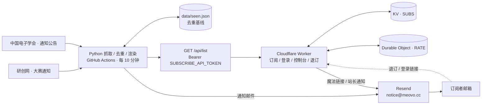

<a id="readme-top"></a>

# 研电赛通知订阅器

[![通知推送][notify-shield]][notify-url]
[![Worker 校验][ci-shield]][ci-url]
[![Cloudflare Workers][cf-shield]][cf-url]
[![Python 3.11+][py-shield]][py-url]
[![TypeScript 5][ts-shield]][ts-url]
[![运行状态][live-shield]][live-url]

> 自动抓取中国研究生电子设计竞赛（研电赛）官方通知，发现更新后合并成一封邮件推送给订阅者。
> 抓取与发信跑在 GitHub Actions，订阅中心跑在 Cloudflare Workers，日常运行完全落在各家免费额度内。

**在线服务**：[https://notice.yds.meovo.cc][live-url] · **仓库**：[ikaraseay/yds-notifier][repo-url] · **文档**：[docs/][docs-url]

<details>
<summary><strong>目录</strong></summary>

<ol>
  <li><a href="#about">项目简介</a></li>
  <li><a href="#features">核心特性</a></li>
  <li><a href="#built-with">技术栈</a></li>
  <li><a href="#architecture">系统架构</a></li>
  <li><a href="#endpoints">在线服务与接口</a></li>
  <li><a href="#getting-started">快速开始</a>
    <ul>
      <li><a href="#prerequisites">前置条件</a></li>
      <li><a href="#installation">本地安装</a></li>
      <li><a href="#testing">测试与构建</a></li>
    </ul>
  </li>
  <li><a href="#deployment">生产部署</a></li>
  <li><a href="#configuration">配置说明</a></li>
  <li><a href="#structure">目录结构</a></li>
  <li><a href="#mail">邮件与订阅体验</a></li>
  <li><a href="#security">安全设计</a></li>
  <li><a href="#maintenance">运维与自定义</a></li>
  <li><a href="#faq">常见问题</a></li>
  <li><a href="#roadmap">路线图</a></li>
  <li><a href="#contributing">贡献指南</a></li>
  <li><a href="#license">许可证</a></li>
  <li><a href="#acknowledgments">致谢</a></li>
</ol>

</details>

<p align="right">(<a href="#readme-top">返回顶部</a>)</p>

---

<a id="about"></a>

## 项目简介

研电赛的赛事通知分散在多个主办方网站，人工刷新既费时又容易错过报名、评审与决赛节点。本项目把这件事自动化：

- **每 10 分钟**检查两个官方渠道的列表页，用稳定 UID 与 `data/seen.json` 比对；
- 只有发现新条目时才抓取详情页补摘要与附件，然后渲染成一封分组邮件；
- 订阅者通过 Cloudflare Worker 自助完成订阅、登录、栏目偏好调整与退订，推送时按偏好过滤；
- 每封邮件的退订链接**按邮箱单独签名**，附带 RFC 8058 一键退订头。

整套系统由两套彼此独立、通过少量契约耦合的服务组成：Python 端负责抓取发信，Worker 端负责用户与名单。二者共享 `UNSUB_SECRET` 与 `SUBSCRIBE_API_TOKEN` 两枚同名同值的密钥。

| 数据源 | 栏目 | 说明 |
|---|---|---|
| [研创网 · 大赛通知](https://cpipc.acge.org.cn/cw/contestNews/list/6/1) | 报名 / 评审 / 决赛 | 官方赛事平台 |
| [中国电子学会 · 通知公告](https://www.cie.org.cn/list_43/) | 赛事动态 | 主办方公告，按关键词过滤 |

<p align="right">(<a href="#readme-top">返回顶部</a>)</p>

<a id="features"></a>

## 核心特性

- **两阶段抓取**：列表页秒级比对，命中才抓详情，高频轮询对源站压力几乎为零。
- **去重基线**：首次运行把现存通知全部记为已读，只发一封最近 8 条的确认邮件，避免一次涌入上百封。
- **魔法链接登录**：无需密码，链接 15 分钟有效且一次性；会话 `SameSite=Lax` Cookie。
- **栏目偏好**：报名参赛 / 评审与名单 / 决赛与收官 / 赛事动态，按人过滤。
- **合规退订**：HTML 模板底部按钮 + `List-Unsubscribe` / `List-Unsubscribe-Post` 头。
- **单一事实源配置**：域名只填一次，所有 URL 与发件人自动派生；`.env` 一处修改可同步到云端两端。
- **自动部署**：Workers Builds 连接 GitHub 后，push 到 `main` 即构建部署 Worker；Python 端由 Actions 定时运行。
- **自定义域名**：`[[routes]] custom_domain = true` 绑定，同时保留 `workers.dev` 备用入口。

<p align="right">(<a href="#readme-top">返回顶部</a>)</p>

<a id="built-with"></a>

## 技术栈

| 层 | 技术 |
|---|---|
| 抓取与发信 | Python 3.11 · requests · BeautifulSoup 4 · PyYAML · python-dotenv · Resend |
| 定时任务 | GitHub Actions（`*/10 * * * *`） |
| 订阅中心 | Cloudflare Workers · TypeScript · esbuild · Wrangler |
| 状态存储 | Workers KV（账号 / 订阅 / 会话） · Durable Objects（限流） |
| 部署 | Cloudflare Workers Builds · Custom Domains |
| 质量保障 | `yds.selftest`（27 项） · Worker e2e（106 项） · `tsc --noEmit` · Wrangler dry-run |

<p align="right">(<a href="#readme-top">返回顶部</a>)</p>

<a id="architecture"></a>

## 系统架构



部署链路：push 到 `main` → Workers Builds 在 `worker/` 目录执行
`npm ci && npm run sync-config && npm run build` → esbuild 产出 `dist/index.js` → `npx wrangler deploy`。
`sync-config` 会先从 `.env` / Build variables 读取自定义域名与 KV id，写入 `wrangler.toml` 的 `AUTO-CONFIG` 区块。

> **注意**：Workers Builds 的 Build variables 只在构建期可见，运行时配置必须填在
> Variables and Secrets；Wrangler 本地调试只读取 `worker/` 同目录的 `.dev.vars`。

<p align="right">(<a href="#readme-top">返回顶部</a>)</p>

<a id="endpoints"></a>

## 在线服务与接口

| 路径 | 方法 | 说明 |
|---|---|---|
| `/` | GET | 订阅首页 |
| `/health` | GET / HEAD | 健康检查（返回 `ok`） |
| `/api/count` | GET | 当前订阅数 |
| `/api/login` | POST | 发送魔法链接（IP / 邮箱 / 全局三重限流） |
| `/login?n=` | GET | 校验一次性链接、建档、写会话并跳转 |
| `/dashboard` | GET | 控制台：栏目偏好、注销、删除账号 |
| `/api/prefs` · `/api/logout` · `/api/delete-account` | POST | 状态变更接口（CSRF 校验） |
| `/unsubscribe` | GET / POST | 按邮箱签名的退订确认与执行 |
| `/api/list` | GET | 订阅名单与偏好，需 `Authorization: Bearer <SUBSCRIBE_API_TOKEN>`，带限流 |

<p align="right">(<a href="#readme-top">返回顶部</a>)</p>

---

<a id="getting-started"></a>

## 快速开始

<a id="prerequisites"></a>

### 前置条件

| 项 | 要求 |
|---|---|
| Python | 3.11+ |
| Node.js | 18+（建议 20 LTS） |
| 账号 | Cloudflare（NS 已托管你的域名）、Resend、GitHub |
| 域名 | 站点域名 + 已通过 Resend 验证的发件域名（二者可以不同） |

<a id="installation"></a>

### 本地安装

```bash
git clone https://github.com/ikaraseay/yds-notifier.git
cd yds-notifier

# Python 端
python3 -m venv .venv
.venv/bin/pip install -r requirements.txt
cp .env.example .env            # 填入真实值，.env 已被 .gitignore 忽略

# Worker 端
cd worker
npm ci
cp .dev.vars.example .dev.vars # 本地调试配置
npm run dev
```

本地常用命令：

```bash
.venv/bin/python -m yds.selftest      # 配置与签名自测，不联网
.venv/bin/python -m yds --check       # 只抓取打印，调试解析器
.venv/bin/python -m yds --dry-run     # 完整流程但不发信
.venv/bin/python -m yds --preview preview.html
```

<a id="testing"></a>

### 测试与构建

```bash
.venv/bin/python -m compileall -q yds && .venv/bin/python -m yds.selftest

cd worker
npm run typecheck     # tsc --noEmit
npm test              # 端到端测试
npm run build         # esbuild → dist/index.js
npx wrangler deploy --dry-run --outdir /tmp/yds-dryrun
```

`.github/workflows/worker-ci.yml` 在每次 push 时自动执行上述校验；
`notify.yml` 额外包含「入口自检」，防止 `python -m yds` 只导入不执行造成静默假成功。

<p align="right">(<a href="#readme-top">返回顶部</a>)</p>

<a id="deployment"></a>

## 生产部署

### 1. Cloudflare Worker

```bash
cd worker
npx wrangler login
npx wrangler kv namespace create SUBS   # 把返回的 id 填进 .env 的 KV_SUBS_ID
npm run sync-config                     # 写入自定义域名 routes 与 KV id
npm run deploy                          # 首次手动部署，之后交给 Workers Builds
```

Dashboard → Worker → **Settings → Builds → Connect to Git**：

| 字段 | 值 |
|---|---|
| Root directory | `worker` |
| Build command | `npm ci && npm run sync-config && npm run build` |
| Deploy command | `npx wrangler deploy` |
| Build variables | `KV_SUBS_ID`；使用自定义域名时加 `CUSTOM_DOMAIN` |

自定义域名要求 zone 已接入 Cloudflare，绑定后 DNS 记录与证书自动创建。
`wrangler.toml` 显式设置 `workers_dev = true`，避免绑定自定义域后备用入口被关闭。

### 2. Resend 发件域名

在 Resend → Domains 添加**发件域**（本项目是根域 `meovo.cc`，不是站点子域），
把控制台给出的 `send`（MX + TXT）与 `resend._domainkey`（TXT）记录加到 Cloudflare，
全部保持 **DNS only（灰云）**。验证通过后创建 Sending access 的 API Key。

> 完整 DNS 记录说明与排障见 [域名发信配置指南](docs/域名发信配置指南.md)。
> Resend 官方推荐用子域发信以隔离声誉；本项目按需求使用根域，功能不受影响。

### 3. 云端配置与密钥

```bash
bash scripts/ops.sh secrets --dry-run   # 预览将同步的键（不上传）
bash scripts/ops.sh secrets             # 同步 Cloudflare + GitHub 两端
```

分别上传也可以直接跑 `scripts/cf-secrets.sh`（Wrangler）与 `scripts/gh-secrets.sh`（gh）。
脚本从 `.env` 读取、跳过空值，密钥只经 stdin / 临时文件传递，不打印明文。
GitHub 侧需要 `gh auth login --web --scopes "repo,workflow"`；也可在两侧控制台手工填写。

| 位置 | 内容 |
|---|---|
| Cloudflare → Secrets | `UNSUB_SECRET` · `SUBSCRIBE_API_TOKEN` · `RESEND_API_KEY`（可选 `UNSUB_SECRET_PREVIOUS`） |
| Cloudflare → Variables | `CUSTOM_DOMAIN` 或 `WORKERS_DEV_URL` · `MAIL_FROM_ADDRESS` · `MAIL_TO`（以及可选显示名 / 限流参数） |
| Cloudflare → Bindings | `SUBS`（KV） · `RATE`（Durable Object，已配好） |
| GitHub → Actions Secrets | 与 Cloudflare 同名同值的密钥、域名、发信配置 |

**三处一致性**：`UNSUB_SECRET` 两端相同；`SUBSCRIBE_API_TOKEN` 两端同名同值；
`CUSTOM_DOMAIN` 两端同值（`UNSUB_URL` / `SUBSCRIBE_API_URL` 自动派生，无需填写）。

### 4. 推送与验证

```bash
git add . && git commit -m "init: 研电赛通知订阅器"
git push origin main
```

推送后 Workers Builds 自动部署；到 Actions 手动 **Run workflow**（mode `normal`）验证发信。
首次运行会建立去重基线并发送一封最近 8 条的确认邮件，之后每 10 分钟自动检查；
无新公告时直接结束、不重复发信、不产生状态提交。

> 完整的环境信息清单（含每一项填到哪里）见
> **[Cloudflare 自动部署指南](docs/Cloudflare自动部署指南.md)** 与 [.env.example](.env.example)。

<p align="right">(<a href="#readme-top">返回顶部</a>)</p>

<a id="configuration"></a>

## 配置说明

`.env` 是**唯一事实源**，优先级为：进程环境变量（CI / Cloudflare 注入）> `.env` > 内置默认值。
`.env` 与 `worker/.dev.vars` 均被忽略，绝不入库；`config.yaml` 只描述业务规则（数据源、白名单、去重、主题前缀）。

每个值只填一次，能推导的绝不重复填：

| 派生项 | 规则 |
|---|---|
| `PUBLIC_BASE_URL` | 显式值 → `https://<CUSTOM_DOMAIN>` → `<WORKERS_DEV_URL>` |
| `UNSUB_URL` | `<生效地址>/unsubscribe` |
| `SUBSCRIBE_API_URL` | `<生效地址>/api/list` |
| `MAIL_FROM` | `MAIL_FROM_NAME <MAIL_FROM_ADDRESS>` |

- **域名只填一处**：改 `CUSTOM_DOMAIN` 后，登录链接、邮件里的退订链接、名单 API 地址全部自动跟随。
- **发件域名独立于站点域名**：站点在 `notice.yds.meovo.cc`，发件人是 `notice@meovo.cc`；
  `MAIL_FROM_ADDRESS` 只需属于 Resend 已验证域名。
- `.env.example` 每项标注去处：`[CF-V]` / `[CF-S]` / `[GH]` / `[构建]` / `[本地]`。
- `npm run sync-config` 把域名与 KV id 写进 `wrangler.toml`；
  `bash scripts/ops.sh secrets` 把运行时配置同步到 Cloudflare 与 GitHub。

<p align="right">(<a href="#readme-top">返回顶部</a>)</p>

<a id="structure"></a>

## 目录结构

```
yds-notifier/
├── .env                          # 唯一事实源（已忽略，不入库）
├── .env.example                  # 模板 + 每项去处标注
├── config.yaml                   # 业务规则：数据源 / 去重 / 主题前缀
├── requirements.txt
├── scripts/
│   ├── ops.sh                    # 运维总入口：doctor / status / deploy / check ...
│   ├── lib.sh                    # 公共函数：配置读取 / 输出 / Wrangler 包装
│   ├── cf-secrets.sh             # .env → Cloudflare Worker Secrets（wrangler bulk）
│   └── gh-secrets.sh             # .env → GitHub Actions Secrets（gh secret set）
├── docs/
│   ├── Cloudflare自动部署指南.md   # Git 集成 + 自定义域名 + 环境变量清单
│   ├── 安全评审报告.md             # 安全评审发现与修复
│   ├── 订阅页面部署指南.md         # 账号体系与接口说明
│   ├── 退订服务部署指南.md         # 退订链路与签名契约
│   └── 域名发信配置指南.md         # Resend + DNS 步骤
├── worker/
│   ├── src/index.ts              # 路由层
│   ├── src/env.ts                # 配置派生：域名 / 多来源白名单
│   ├── src/security.ts           # 签名 / CSRF / CSP / 校验
│   ├── src/auth.ts · rate.ts · mailer.ts
│   ├── src/ui/                   # 界面层：styles / scripts / layout / pages
│   ├── src/handlers/             # 后端逻辑层：login / dashboard / unsubscribe / api
│   ├── scripts/sync-config.mjs   # .env → wrangler.toml（自定义域名 + KV id）
│   ├── wrangler.toml             # main = dist/index.js，AUTO-CONFIG 区块
│   ├── .dev.vars.example         # 本地调试配置模板
│   └── tests/worker.e2e.mjs      # 端到端测试
├── data/seen.json                # 已推送记录（Actions 自动提交回仓库）
├── .github/workflows/
│   ├── notify.yml                # 定时抓取发信 + 状态回写
│   └── worker-ci.yml             # 类型检查 / 测试 / 构建
└── yds/
    ├── config.py                 # 统一读取 .env 与域名派生
    ├── models.py · fetch.py · sources.py · state.py
    ├── mailer.py · senders.py · recipients.py · unsub.py
    ├── main.py · __main__.py     # 命令行入口
    └── selftest.py               # 离线自测：配置 / 签名 / 收件人
```

<p align="right">(<a href="#readme-top">返回顶部</a>)</p>

<a id="mail"></a>

## 邮件与订阅体验

订阅页、批量通知邮件、登录/注册邮件与站长通知邮件**共用一套孟菲斯主题**：
奶油纸底 `#FFF4E4`、墨色 `#2E2A33` 粗描边、黄 `#FFD93D` / 珊瑚 `#FF6B6B` / 蓝 `#4D96FF` 撞色块，
小圆角、硬阴影与波点节奏，全部用 table + 内联样式实现，兼容 QQ 邮箱 / 163 / Gmail，
**全程不使用 emoji**。

批量通知按「报名参赛 / 评审与名单 / 决赛与收官 / 赛事动态」分组，HTML + 纯文本双格式，
按时段变化问候；底部提供退订按钮与 RFC 8058 一键退订头。
收件人可在控制台勾选栏目，推送时按偏好过滤。

| 项 | 实际情况 |
|---|---|
| 检查间隔 | 10 分钟（cron `*/10 * * * *`） |
| 实际延迟 | 通常 10 分钟内，GitHub 高峰期可能多几分钟 |
| 单次成本 | 无新公告时只请求列表页，不抓详情页 |
| 费用 | 仓库需为 **Public** 才完全免费（Private 仓库 144 次/天会超出免费分钟数） |

<p align="right">(<a href="#readme-top">返回顶部</a>)</p>

<a id="security"></a>

## 安全设计

项目做过一次完整安全评审，发现 3 项严重 + 5 项高危问题并全部修复，详见 [安全评审报告](docs/安全评审报告.md)。

| 风险 | 防护措施 |
|---|---|
| Host 头注入钓鱼 | 对外链接只由 `CUSTOM_DOMAIN` / 显式地址派生，不信任请求 Host；缺失即 fail-closed |
| 单人退订影响所有人 | 移除全局退订分支与 GitHub PAT；退订按邮箱签发，Worker 不持有 GitHub 凭据 |
| 退订链接伪造 | HMAC-SHA256 + 显式过期时间 + 常量时间比较，支持双密钥轮换 |
| CSRF / 越权方法 | `Origin` + `Sec-Fetch-Site` 白名单、SameSite Cookie、method 白名单与 405 |
| XSS / 点击劫持 | 每次响应随机 CSP nonce、全量 HTML 转义、`X-Frame-Options: DENY` |
| 内部信息泄露 | 上游异常只写日志，对访客返回统一文案 |
| 接口滥用 | Durable Object 按 IP / 邮箱 / 全局 / 名单 API 四重限流 |
| SSRF | 源站 host 白名单与 URL scheme / 邮箱 CRLF 校验 |
| 凭据泄露 | `.env` / `.dev.vars` / `dist` / `node_modules` 全部忽略；Actions 权限收敛到 job 级 |

<p align="right">(<a href="#readme-top">返回顶部</a>)</p>

<a id="maintenance"></a>

## 运维与自定义

日常操作统一走 `bash scripts/ops.sh <命令>`（沿用其它项目运维脚本的约定：
`lib.sh` 公共库 + 彩色 `step/ok/warn/die`，警告走 stderr，密钥一律不回显）：

| 命令 | 作用 |
|---|---|
| `doctor` | 一次性体检：工具链、配置、两端登录与密钥、KV id 一致性、线上健康 |
| `status` | 查看配置、线上端点、最近部署与 Actions 运行 |
| `config show\|get\|set\|check` | 查看 / 修改 / 校验 `.env`（`show` 自动脱敏） |
| `secrets` | 从 `.env` 同步密钥到 Cloudflare + GitHub（支持 `--dry-run`） |
| `cf-secrets` / `gh-secrets` | 只同步其中一端（支持 `--only KEY` / `--list`） |
| `dev-vars` | 从 `.env` 生成 `worker/.dev.vars` 供 `wrangler dev` 使用 |
| `check` | Python 自测 + Worker 类型/测试/构建 + Wrangler 干跑 |
| `deploy` | 构建并部署 Worker，随后探测 `/health` |
| `notify normal\|check` / `logs` | 触发或查看 GitHub Actions |
| `login` / `logout` | 登录 / 登出 Cloudflare |

| 想做的事 | 改哪里 |
|---|---|
| 增删数据源 / 改抓取深度 | `config.yaml` |
| 接入新站点 | `yds/sources.py` 继承 `BaseSource`，并配置 `allowed_hosts` |
| 更换发信服务商 | `yds/senders.py` 继承 `BaseSender` |
| 调整邮件样式 | `yds/mailer.py` 的 `build_html` |
| 修改 Worker 界面 / 后端 | `worker/src/ui/` / `worker/src/handlers/` |
| 调整栏目 | 同步修改 `worker/src/auth.ts` 的 `CATEGORIES` 与 `yds/recipients.py` 的 `CATEGORY_TO_KEY` |
| 更换站点域名 | 改 `.env` 的 `CUSTOM_DOMAIN`，跑 `bash scripts/ops.sh secrets` 与 `bash scripts/ops.sh deploy` |
| 更换发件地址 | 改 `.env` 的 `MAIL_FROM_ADDRESS` 并跑 `bash scripts/ops.sh secrets`；Resend 侧需先验证该域名 |

<p align="right">(<a href="#readme-top">返回顶部</a>)</p>

<a id="faq"></a>

## 常见问题

| 现象 | 排查方向 |
|---|---|
| 收不到邮件 | 看 Actions 日志；`403 domain is not verified` 是 DNS 未验证，`535` 是 SMTP 授权码错误 |
| 登录接口 500 / 502 | 对外地址三个变量一个都没配（fail-closed）；或 Worker 缺 `RESEND_API_KEY` |
| 点「进入控制台」无邮件 | Cloudflare 的 `RESEND_API_KEY` 与 GitHub 侧是两个独立配置，两边都要填 |
| 自定义域生效后 workers.dev 404 | `workers_dev` 被关闭，本项目 `wrangler.toml` 已显式设为 `true` |
| 退订链接提示失效 | 多为两端 `UNSUB_SECRET` 不一致，或链接超过 `UNSUB_TTL_DAYS`（默认 180 天） |
| Worker 读不到变量 | 变量填进了 Build variables（仅构建期可见），应移到 Variables and Secrets |
| Actions 报 `pathspec 'data/seen.json'` | 状态文件未生成；工作流已做容错，也可用仓库内预置的空状态文件恢复 |
| 会不会漏通知 | 状态回写失败时下轮会重发未确认的通知，宁可重复、不漏发 |

<p align="right">(<a href="#readme-top">返回顶部</a>)</p>

---

<a id="roadmap"></a>

## 路线图

- [x] 两阶段抓取与去重基线
- [x] 魔法链接登录、栏目偏好、注销与删除账号
- [x] 按邮箱签名退订与 RFC 8058 一键退订
- [x] 自定义域名与 Workers Builds 自动部署
- [x] 完整安全评审与修复
- [ ] DMARC 策略与送达率监控
- [ ] 更多官方渠道与关键词配置化
- [ ] 订阅增长与退订原因的可视化统计

欢迎通过 [Issues][issues-url] 提出建议或报告问题。

<p align="right">(<a href="#readme-top">返回顶部</a>)</p>

<a id="contributing"></a>

## 贡献指南

1. Fork 本仓库，创建特性分支：`git checkout -b feature/your-feature`
2. 提交前跑通本地校验：`yds.selftest`、`npm run typecheck`、`npm test`、`npm run build`
3. 提交变更：`git commit -m "feat: ..."` 并发起 Pull Request

**请勿提交任何真实凭据**：`.env`、`worker/.dev.vars`、`dist/`、`node_modules/`
均已忽略；如新增配置项，请同步更新 `.env.example` 与 `worker/.dev.vars.example`。

<p align="right">(<a href="#readme-top">返回顶部</a>)</p>

<a id="license"></a>

## 许可证

本项目当前**未指定开源许可证**，主要用于个人学习与自用部署。
如需以明确的开源许可发布，请先与维护者确认并补充 `LICENSE` 文件。

<p align="right">(<a href="#readme-top">返回顶部</a>)</p>

<a id="acknowledgments"></a>

## 致谢

- [Cloudflare Workers](https://developers.cloudflare.com/workers/) · Workers KV · Durable Objects · Workers Builds
- [Resend](https://resend.com/docs) · [GitHub Actions](https://docs.github.com/actions)
- [Beautiful Soup](https://www.crummy.com/software/BeautifulSoup/) · [esbuild](https://esbuild.github.io/) · [Wrangler](https://developers.cloudflare.com/workers/wrangler/)
- [Shields.io](https://shields.io) · [Best-README-Template](https://github.com/othneildrew/Best-README-Template)

<p align="right">(<a href="#readme-top">返回顶部</a>)</p>

<!-- MARKDOWN LINKS -->
[notify-shield]: https://github.com/ikaraseay/yds-notifier/actions/workflows/notify.yml/badge.svg
[notify-url]: https://github.com/ikaraseay/yds-notifier/actions/workflows/notify.yml
[ci-shield]: https://github.com/ikaraseay/yds-notifier/actions/workflows/worker-ci.yml/badge.svg
[ci-url]: https://github.com/ikaraseay/yds-notifier/actions/workflows/worker-ci.yml
[cf-shield]: https://img.shields.io/badge/Cloudflare-Workers-F38020?logo=cloudflare&logoColor=white
[cf-url]: https://developers.cloudflare.com/workers/
[py-shield]: https://img.shields.io/badge/Python-3.11%2B-3776AB?logo=python&logoColor=white
[py-url]: https://www.python.org/
[ts-shield]: https://img.shields.io/badge/TypeScript-5-3178C6?logo=typescript&logoColor=white
[ts-url]: https://www.typescriptlang.org/
[live-shield]: https://img.shields.io/badge/status-live-brightgreen
[live-url]: https://notice.yds.meovo.cc
[repo-url]: https://github.com/ikaraseay/yds-notifier
[docs-url]: https://github.com/ikaraseay/yds-notifier/tree/main/docs
[issues-url]: https://github.com/ikaraseay/yds-notifier/issues
