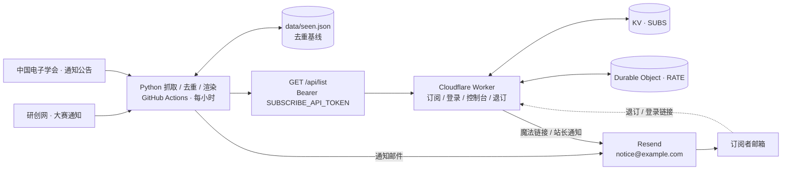

<a id="readme-top"></a>

# 研电赛通知订阅器

[![通知推送][notify-shield]][notify-url]
[![Worker 校验][ci-shield]][ci-url]
[![Cloudflare Workers][cf-shield]][cf-url]
[![Python 3.11+][py-shield]][py-url]
[![TypeScript 5][ts-shield]][ts-url]
[![运行状态][live-shield]][live-url]

> 自动抓取中国研究生电子设计竞赛（研电赛）官方通知，发现更新后合并成一封邮件推送给订阅者。
> 抓取与发信跑在 GitHub Actions，订阅中心跑在 Cloudflare Workers，日常运行完全落在各家免费额度内。

**在线服务**：[https://notice.example.com][live-url] · **仓库**：[ikaraseay/yds-notifier][repo-url] · **文档**：[docs/][docs-url]

<details>
<summary><strong>目录</strong></summary>

<ol>
  <li><a href="#about">项目简介</a></li>
  <li><a href="#features">核心特性</a></li>
  <li><a href="#built-with">技术栈</a></li>
  <li><a href="#architecture">系统架构</a></li>
  <li><a href="#endpoints">在线服务与接口</a></li>
  <li><a href="#getting-started">快速开始</a>
    <ul>
      <li><a href="#prerequisites">前置条件</a></li>
      <li><a href="#installation">本地安装</a></li>
      <li><a href="#testing">测试与构建</a></li>
    </ul>
  </li>
  <li><a href="#deployment">生产部署</a></li>
  <li><a href="#configuration">配置说明</a></li>
  <li><a href="#structure">目录结构</a></li>
  <li><a href="#mail">邮件与订阅体验</a></li>
  <li><a href="#security">安全设计</a></li>
  <li><a href="#maintenance">运维与自定义</a></li>
  <li><a href="#faq">常见问题</a></li>
  <li><a href="#roadmap">路线图</a></li>
  <li><a href="#contributing">贡献指南</a></li>
  <li><a href="#disclaimer">数据来源与免责声明</a></li>
  <li><a href="#license">许可证</a></li>
  <li><a href="#acknowledgments">致谢</a></li>
</ol>

</details>

<p align="right">(<a href="#readme-top">返回顶部</a>)</p>

---

<a id="about"></a>

## 项目简介

研电赛的赛事通知分散在多个主办方网站，人工刷新既费时又容易错过报名、评审与决赛节点。本项目把这件事自动化：

- **每小时**检查研创网的多个栏目与主办方公告，用稳定 UID 与 `data/seen.json` 比对；
- 只有发现新条目时才抓取详情页补摘要与附件，然后渲染成一封分组邮件；
- 订阅者通过 Cloudflare Worker 自助完成订阅、登录、栏目偏好调整与退订，推送时按偏好过滤；
- 每封邮件的退订链接**按邮箱单独签名**，附带 RFC 8058 一键退订头。

整套系统由两套彼此独立、通过少量契约耦合的服务组成：Python 端负责抓取发信，Worker 端负责用户与名单。二者共享 `UNSUB_SECRET` 与 `SUBSCRIBE_API_TOKEN` 两枚同名同值的密钥。

| 数据源 | 栏目 | 说明 |
|---|---|---|
| [研创网 · 研电赛专区](https://cpipc.acge.org.cn/cw/contestNews/list/6/1) | 报名 / 评审 / 决赛 | 官方赛事平台，赛事 id=6 |
| 研创网 · 各赛事专区 | 19 项赛事 | 按用户关注抓取，其余每轮轮询 4 项 |
| [研创网 · 大赛通知](https://cpipc.acge.org.cn/pw/notice/list/1) | 全站通知 | 赛程一览、年度启动、承办征集 |
| [研创网 · 大赛新闻](https://cpipc.acge.org.cn/pw/news/list/1) | 赛事动态 | 各主题赛事新闻 |
| [研创网 · 大赛文件](https://cpipc.acge.org.cn/pw/document/list/1) | 章程 / 材料 | 长期有效文件 |
| [中国电子学会 · 通知公告](https://www.cie.org.cn/list_43/) | 主办方公告 | 按关键词过滤 |

> 通知计划（人员视角、阶段矩阵、提醒节奏）见 [`docs/通知计划.md`](docs/通知计划.md)。
>
> ⚠️ **数据源站点的 `robots.txt` 明确禁止一切爬虫抓取，本项目未获授权**。
> 抓取范围、频率、停止与删除办法见 [数据来源与免责声明](#disclaimer)，请先阅读再部署。

<p align="right">(<a href="#readme-top">返回顶部</a>)</p>

<a id="features"></a>

## 核心特性

- **两阶段抓取**：列表页秒级比对，命中才抓详情，高频轮询对源站压力几乎为零。
- **抓取并发与去重**：列表 / 详情都用线程池并发（单轮 37s → 15s），同一 URL 一轮只请求一次，**同一主机最多 2 个在途请求**——变快不等于给官网加压。
- **去重基线**：首次运行把现存通知全部记为已读，只发一封最近 8 条的确认邮件，避免一次涌入上百封。
- **魔法链接登录**：无需密码，链接 15 分钟有效且一次性；会话 `SameSite=Lax` Cookie。
- **栏目偏好**：报名参赛 / 评审与名单 / 决赛与收官 / 赛事动态，按人过滤。
- **合规退订**：HTML 模板底部按钮 + `List-Unsubscribe` / `List-Unsubscribe-Post` 头。
- **单一事实源配置**：域名只填一次，所有 URL 与发件人自动派生；`.env` 一处修改可同步到云端两端。
- **自动部署**：Workers Builds 连接 GitHub 后，push 到 `main` 即构建部署 Worker；Python 端由 Actions 定时运行。
- **自定义域名**：`[[routes]] custom_domain = true` 绑定，同时保留 `workers.dev` 备用入口。
- **内容变更检测**：列表页指纹 + 每日一次详情抽检；官网改标题、补正文、加附件、延长截止都会以「【更新】」重推。
- **点一次即完成订阅确认**：登录链接只发到本人邮箱，点开即视为邮箱验证与订阅同意（double opt-in），随后发欢迎邮件并记录同意时间。
- **频率与暂停**：控制台可选即时 / 日报 / 周报，或暂停到指定日期；暂停期间的通知随恢复后的摘要补上。
- **归档 · RSS**：`/archive`、`/feed.xml` 无需注册即可查看通知；日历改为**个人订阅制**，只对本人签发。
- **归档日历视图**：月历格子直接标出「节点名 + 来源」，右上角数字是当天节点数；点格子跳到当天日程（锚点高亮），节点标题链回原文；月份可用「上月 / 下月 / 本月」或折叠的 12 个月网格快速切换，翻月保留当前筛选。
- **退订挽留与统计**：退订页收集原因并提供「改成周报」；`/api/stats` 输出统计。
- **失败可见**：发信失败不写已读状态、下轮重试；Actions 失败告警 + 成功心跳；Resend webhook 验签后自动清理退信 / 投诉地址。
- **AI 推送分析**：用 OpenAI 兼容接口（默认 DeepSeek）做分类、一句话摘要、紧急度判断与**公告正文里的真实事件日期抽取**；提示词独立存放在 `prompts/`，结果按内容指纹缓存。
- **智能推送编排**：AI 判为 `critical` 的通知走「紧急快报」，无视日报/周报设置立即送达；低价值动态在摘要里折叠；邮件与归档页展示 AI 摘要与日程。
- **官方赛程驱动**：解析《各主题赛事赛程一览》，把 19 项赛事的报名 / 提交 / 决赛写进日历，并在截止前 T-30 / T-7 / T-3 / T-1 发提醒——官网不发新通知也有信息。
- **人员视角**：每条通知标注赛事、阶段（报名/资格审查/缴费/提交作品/评审/决赛/公示/获奖/报销/承办/动态）与面向人群（学生/导师/培养单位/赛区）；邮件顶部只按你勾选的角色分组，标题就是角色名。
- **后台自助设置**：控制台可选「我的角色」四栏（学生 / 导师 / 培养单位 / 赛区）、关注赛事（19 项 + EDA 专项）、栏目、频率与暂停；筛选是「栏目 × 角色 × 赛事」三层交集。
- **角色版邮件**：只选一个角色的订阅者收到该角色专版，主题带 `〔参赛学生〕`，正文按赛事分组，每组附该赛事的日历 / 归档链接；多角色则发综合版。
- **赛事级筛选**：个人日历地址可再带 `&contest=电子设计竞赛` 只看单个赛事，`/archive?contest=…` 只看该赛事归档。
- **个人日历**：**公共日历已下线**，日历只认 `calendar.ics?email=…&token=…` 这种签名链接；Worker 校验后按**该用户的角色 + 关注赛事**过滤事件，改设置即自动同步，无需重新订阅。`cal` 与 `unsub` 是两套签名域，日历链接泄漏也不能拿去退订，无签名请求一律 401。
- **低 KV 压力**：通知与赛程合并成一次读取，isolate 内 60 秒缓存 + KV `cacheTtl`；每次个人日历轮询是 2 次读（首拉）/ 1 次读（缓存期内）。
- **视角级订阅**：`config.yaml` 的 `personas[].mail_to` 可给学生、导师、培养单位分别发专用版；未配置邮件地址时按订阅者自己的角色设置发信。

<p align="right">(<a href="#readme-top">返回顶部</a>)</p>

<a id="built-with"></a>

## 技术栈

| 层 | 技术 |
|---|---|
| 抓取与发信 | Python 3.11 · requests · BeautifulSoup 4 · PyYAML · python-dotenv · Resend |
| 定时任务 | GitHub Actions（`0 * * * *`，每小时） |
| 订阅中心 | Cloudflare Workers · TypeScript · esbuild · Wrangler |
| 状态存储 | Workers KV（账号 / 订阅 / 会话） · Durable Objects（限流） |
| 部署 | Cloudflare Workers Builds · Custom Domains |
| 质量保障 | `yds.selftest`（124 项，FAIL 返回非零） · Worker e2e（167 项） · `tsc --noEmit` · Wrangler dry-run |

<p align="right">(<a href="#readme-top">返回顶部</a>)</p>

<a id="architecture"></a>

## 系统架构



部署链路：push 到 `main` → Workers Builds 在 `worker/` 目录执行
`npm ci && npm run sync-config && npm run build` → esbuild 产出 `dist/index.js` → `npx wrangler deploy`。
`sync-config` 会先从 `.env` / Build variables 读取自定义域名与 KV id，写入 `wrangler.toml` 的 `AUTO-CONFIG` 区块。

> **注意**：Workers Builds 的 Build variables 只在构建期可见，运行时配置必须填在
> Variables and Secrets；Wrangler 本地调试只读取 `worker/` 同目录的 `.dev.vars`。

<p align="right">(<a href="#readme-top">返回顶部</a>)</p>

<a id="endpoints"></a>

## 在线服务与接口

| 路径 | 方法 | 说明 |
|---|---|---|
| `/` | GET | 订阅首页 |
| `/health` | GET / HEAD | 健康检查（返回 `ok`） |
| `/api/count` | GET | 当前订阅数 |
| `/api/login` | POST | 发送魔法链接（IP / 邮箱 / 全局三重限流） |
| `/login?n=` | GET | 校验一次性链接、建档、写会话并跳转 |
| `/dashboard` | GET | 控制台：栏目偏好、注销、删除账号 |
| `/api/prefs` · `/api/logout` · `/api/delete-account` | POST | 状态变更接口（CSRF 校验） |
| `/unsubscribe` | GET / POST | 按邮箱签名的退订确认与执行 |
| `/api/list` | GET | 订阅名单与偏好（含频率 / 暂停），需 `Authorization: Bearer <SUBSCRIBE_API_TOKEN>`，带限流 |
| `/confirm?c=` | GET | 确认订阅（一次性链接），完成后发欢迎邮件 |
| `/api/confirm/resend` | POST | 重发确认邮件（每邮箱每小时 3 次） |
| `/archive` · `/feed.xml` | GET | 通知归档页 / RSS 2.0（`/archive` 支持 `?contest=` / `?audience=`） |
| `/calendar.ics` | GET | **个人日历**，必须带 `?email=&token=` 签名，否则 401；可叠加 `&contest=` / `&audience=` |
| `/api/notices` | POST | Python 同步通知元数据（公开字段），Bearer 鉴权 |
| `/api/stats` | GET | 退订原因与降频统计，Bearer 鉴权 |
| `/api/webhooks/resend` | POST | Resend webhook（Svix 验签），自动清理退信 / 投诉地址 |
| `/robots.txt` · `/llms.txt` | GET / HEAD | 爬虫规则（个人页面不进索引）与 AI 代理说明 |
| `/favicon.svg` · `/favicon.ico` | GET / HEAD | 站点图标（内联 SVG） |

<p align="right">(<a href="#readme-top">返回顶部</a>)</p>

---

<a id="getting-started"></a>

## 快速开始

<a id="prerequisites"></a>

### 前置条件

| 项 | 要求 |
|---|---|
| Python | 3.11+ |
| Node.js | 18+（建议 20 LTS） |
| 账号 | Cloudflare（NS 已托管你的域名）、Resend、GitHub |
| 域名 | 站点域名 + 已通过 Resend 验证的发件域名（二者可以不同） |

<a id="installation"></a>

### 本地安装

```bash
git clone https://github.com/ikaraseay/yds-notifier.git
cd yds-notifier

# Python 端
python3 -m venv .venv
.venv/bin/pip install -r requirements.txt
cp .env.example .env            # 填入真实值，.env 已被 .gitignore 忽略

# Worker 端
cd worker
npm ci
cp .dev.vars.example .dev.vars # 本地调试配置
npm run dev
```

本地常用命令：

```bash
.venv/bin/python -m yds.selftest      # 配置与签名自测，不联网
.venv/bin/python -m yds --check       # 只抓取打印，调试解析器
.venv/bin/python -m yds --dry-run     # 完整流程但不发信
.venv/bin/python -m yds --preview preview.html
```

<a id="testing"></a>

### 测试与构建

```bash
.venv/bin/python -m compileall -q yds && .venv/bin/python -m yds.selftest

cd worker
npm run typecheck     # tsc --noEmit
npm test              # 端到端测试
npm run build         # esbuild → dist/index.js
npx wrangler deploy --dry-run --outdir /tmp/yds-dryrun
```

`.github/workflows/worker-ci.yml` 在每次 push 时自动执行上述校验；
`notify.yml` 额外包含「入口自检」，防止 `python -m yds` 只导入不执行造成静默假成功。

<p align="right">(<a href="#readme-top">返回顶部</a>)</p>

<a id="deployment"></a>

## 生产部署

### 1. Cloudflare Worker

```bash
cd worker
npx wrangler login
npx wrangler kv namespace create SUBS   # 把返回的 id 填进 .env 的 KV_SUBS_ID
npm run sync-config                     # 写入自定义域名 routes 与 KV id
npm run deploy                          # 首次手动部署，之后交给 Workers Builds
```

Dashboard → Worker → **Settings → Builds → Connect to Git**：

| 字段 | 值 |
|---|---|
| Root directory | `worker` |
| Build command | `npm ci && npm run sync-config && npm run build` |
| Deploy command | `npx wrangler deploy` |
| Build variables | `KV_SUBS_ID`；使用自定义域名时加 `CUSTOM_DOMAIN` |

自定义域名要求 zone 已接入 Cloudflare，绑定后 DNS 记录与证书自动创建。
`wrangler.toml` 显式设置 `workers_dev = true`，避免绑定自定义域后备用入口被关闭。

### 2. Resend 发件域名

在 Resend → Domains 添加**发件域**（本项目是根域 `example.com`，不是站点子域），
把控制台给出的 `send`（MX + TXT）与 `resend._domainkey`（TXT）记录加到 Cloudflare，
全部保持 **DNS only（灰云）**。验证通过后创建 Sending access 的 API Key。

> 完整 DNS 记录说明与排障见 [域名发信配置指南](docs/域名发信配置指南.md)。
> Resend 官方推荐用子域发信以隔离声誉；本项目按需求使用根域，功能不受影响。

### 3. 云端配置与密钥

```bash
bash scripts/ops.sh secrets --dry-run   # 预览将同步的键（不上传）
bash scripts/ops.sh secrets             # 同步 Cloudflare + GitHub 两端
```

分别上传也可以直接跑 `scripts/cf-secrets.sh`（Wrangler）与 `scripts/gh-secrets.sh`（gh）。
脚本从 `.env` 读取、跳过空值，密钥只经 stdin / 临时文件传递，不打印明文。
GitHub 侧需要 `gh auth login --web --scopes "repo,workflow"`；也可在两侧控制台手工填写。

| 位置 | 内容 |
|---|---|
| Cloudflare → Secrets | `UNSUB_SECRET` · `SUBSCRIBE_API_TOKEN` · `RESEND_API_KEY`（可选 `UNSUB_SECRET_PREVIOUS`、`RESEND_WEBHOOK_SECRET`） |
| Cloudflare → Variables | `CUSTOM_DOMAIN` 或 `WORKERS_DEV_URL` · `MAIL_FROM_ADDRESS` · `MAIL_TO`（可选显示名、限流参数） |
| Cloudflare → Bindings | `SUBS`（KV） · `RATE`（Durable Object，已配好） |
| GitHub → Actions Secrets | 与 Cloudflare 同名同值的密钥、域名、发信配置；`AI_API_KEY`（DeepSeek）；可选 `PUBLISH_NOTICES`、`HEARTBEAT_URL`、`ALERT_WEBHOOK_URL` |

**三处一致性**：`UNSUB_SECRET` 两端相同；`SUBSCRIBE_API_TOKEN` 两端同名同值；
`CUSTOM_DOMAIN` 两端同值（`UNSUB_URL` / `SUBSCRIBE_API_URL` / `NOTICES_API_URL` 自动派生，无需填写）。

### AI 分析配置

AI 只在 **GitHub Actions 的 Python 端**运行，Cloudflare Worker 不调用模型，因此
`AI_API_KEY` 只需填成 GitHub Secret。默认走 DeepSeek 的 OpenAI 兼容接口：

| 配置 | 默认值 | 说明 |
|---|---|---|
| `AI_ENABLED` | `true` | 关闭后退回关键词分类 + 正则日期，不影响发信 |
| `AI_API_KEY` | 空 | **必填**，DeepSeek 控制台创建；留空即自动降级 |
| `AI_BASE_URL` | `https://api.deepseek.com` | 换 provider 只改这里 |
| `AI_MODEL` | `deepseek-flash` | 也可填 `deepseek-v4-pro` 或任意兼容模型 |
| `AI_THINKING` | `false` | 默认关闭：稳定 JSON、低延迟、更便宜 |
| `AI_TEMPERATURE` | `0.1` | 仅非 thinking 模式生效 |
| `AI_MAX_TOKENS` | `4096` | 留够，否则 JSON 会被截断 |
| `AI_BATCH_SIZE` / `AI_TIMEOUT` | `8` / `60` | 批量条数 / 超时秒数 |
| `AI_MAX_BODY_CHARS` | `3000` | 单条正文截断长度 |

提示词在 `prompts/` 目录，版本由 `prompts/manifest.yaml` 的 `active` 决定；
当前 `active: v2`，在 v1 的分类/摘要/紧急度/事件日期之外，额外输出
**赛事名、阶段、面向人群、行动建议**四类字段。改版本会让 `data/ai.json`
缓存全量失效重算。完整设计（调研、数据契约、防幻觉策略、降级链、成本）见
[AI 推送设计方案](docs/AI推送设计方案.md)。

> 即使不填 `AI_API_KEY`，日历修复依然生效：系统会渐进回填历史公告正文，
> 用确定性规则抽出真实事件日。AI 只是把准确率从「规则」提升到「语义级」。

### 通知计划配置

`config.yaml` 里与「人员视角 / 赛程提醒」相关的段：

```yaml
max_age_days: 540            # 兼容旧配置；新配置用 push_max_age_days
push_max_age_days: 60        # 超过该天数的「新条目」只归档、不推送
catchup_threshold: 10        # 单轮新增超过该数 → 进入追赶模式
catchup_size: 8              # 追赶模式只推最近 N 条，其余静默归档

schedule:
  enabled: true
  refresh_days: 7            # 赛程表每周刷新一次
  horizons: [30, 7, 3, 1]    # 截止前第 N 天提醒
  include: [电子设计竞赛]     # 只为这些赛事生成提醒

personas:
  - key: student             # student / advisor / admin / organizer
    name: 参赛学生
    mail_to: ""              # 留空跟随 MAIL_TO；填了额外单独发一版
```

各赛事独立专区默认全部启用，按订阅者关注的赛事优先抓取；无人限制时每轮轮询 4 项
（游标存 `data/zones.json`，约 1 小时覆盖全部 19 项）。想缩小范围：

```yaml
sources:
  - key: cpipc_zones
    enabled: true
    per_run: 4
    contests:
      - 电子设计竞赛
      - 创“芯”大赛
```

> 完整的人员视角矩阵、阶段定义、触发规则与降噪策略见
> [`docs/通知计划.md`](docs/通知计划.md)。

本轮新增的可选配置：`RESEND_WEBHOOK_SECRET`（Resend → Webhooks 的签名密钥，端点填
`https://<站点>/api/webhooks/resend`，勾选 `email.bounced` / `email.complained` / `suppression.added`）、
`PUBLISH_NOTICES`（归档同步开关）、`HEARTBEAT_URL`（外部 dead-man switch 的 ping 地址）与
`ALERT_WEBHOOK_URL`（失败时接收 POST JSON 的告警地址）。空值会被同步脚本跳过。

#### 状态存储放到 R2（可选，推荐）

默认仍把 `data/*.json` 提交回仓库（旧行为，零配置）。填了下面五项，状态就改放
Cloudflare R2：仓库里不再出现 bot 的状态提交，也不再有 `git pull --rebase` 冲突。

| 变量 | 说明 |
|---|---|
| `R2_ACCOUNT_ID` | Cloudflare 账户 ID（R2 页右上角可复制） |
| `R2_ACCESS_KEY_ID` / `R2_SECRET_ACCESS_KEY` | R2 → 管理 API 令牌 → 创建「对象读写」令牌后得到 |
| `R2_BUCKET` | 桶名，例如 `yds-state`；为空即不启用 |
| `R2_PREFIX` | 对象前缀，默认 `state`（多个环境可共用一个桶） |
| `STATE_BACKEND` | `auto`（默认）/ `local`（强制回到 git 回写） |

对象布局是 `state/<文件名>.json.gz`，一个状态一个对象；远端 gzip 后约 **166 KB**
（原 `ai.json` 572 KB）。上传带 `If-Match` 条件写：**远端被别人改过就报冲突并保留对方版本**，
不会静默覆盖。内容没变的文件不会产生任何写操作。

两条保护，都是为了避免"把老通知再群发一遍"：

- 配了 R2 但**读不到**（网络 / 权限 / 桶名错）→ 直接中止，不拿仓库里的陈旧副本当基线；
- 首次写回会落一个 `state/_ready.json` 标记。今后若**标记还在、状态对象全丢**
  （桶被清空 / 前缀写错）→ 同样中止，而不是误判成首次运行。

写回失败时应用会落 `data/.state-push-failed`，CI 的「保存状态」步骤检测到就把构建标红 ——
`atexit` 改不了退出码，但流水线不能是绿的。

首次启用只需一条命令（顺序是为了**让远端基线等于最新已发布状态**，
否则下一轮会把这几天推过的通知再发一遍）：

```bash
# 桶已建好（yds-state）。先在控制台 R2 → Manage API Tokens 建一个
# Object Read & Write、仅限 yds-state 的令牌，然后：
R2_ACCESS_KEY_ID=… R2_SECRET_ACCESS_KEY=… bash scripts/ops.sh r2 enable
```

脚本会依次做五件事，任何一步不通过就停下：凭证落 `.env` → 连通性检查 →
用 `origin/main` 的 `data/` 快照建立远端基线 → 逐对象比对（必须全「一致」）→
最后才同步 GitHub Secrets 切换 CI。`--dry-run` 只看不动，`--no-secrets` 只建基线。

日常都用 `ops.sh r2` 这一个入口：

| 命令 | 用途 |
|---|---|
| `ops.sh r2` / `r2 status` | 列远端对象、字节数、时间戳 |
| `ops.sh r2 diff` | 本地 `data/` 与远端逐对象比对（哪些会被上传） |
| `ops.sh r2 refresh` | 用最新 `origin/main` 覆盖远端基线（发布前对齐） |
| `ops.sh r2 seed` | 建基线（远端已有状态时拒绝，`--force` 才覆盖） |
| `ops.sh r2 pull` | 拉到 `.r2-preview/` 检查，不动 `data/` |
| `ops.sh r2 enable` | 首次启用 / 换凭证后重跑 |

`ops.sh doctor` 与 `ops.sh status` 也会带上状态后端：前者验证 R2 可达并检查
本地与远端是否漂移，后者只显示一行摘要。

凭证格式有个坑：R2 的 **Access Key ID 等于 API 令牌的 id**（32 位十六进制），
**Secret 等于令牌的 sha256**（64 位十六进制）。控制台建令牌时会直接给这两个值，
粘成令牌本身（`cfat_…`）S3 会报 `Credential access key has length 53, should be 32`。

状态一旦切到 R2，CI 就不再提交 `data/*.json`。但如果**代码还没上线**（CI 仍跑旧版、
继续把状态写回 git），远端的基线会落后于仓库。这种窗口期里每次发布前先对齐一次：

```bash
bash scripts/ops.sh r2 refresh   # = r2-enable.sh --refresh --no-secrets
```

否则上线首轮会拿旧基线比对，把窗口期内推过的通知再发一遍。

单独排查用 `scripts/r2_state.py`：`check` 列远端对象、`diff` 比对哈希、
`seed` 建基线（远端已有状态时拒绝执行，`--force` 才覆盖）、`pull --to DIR` 拉到临时目录。
它只读写对象存储，不抓取、不发信、不动 `data/`。

### 4. 推送与验证

```bash
git add . && git commit -m "init: 研电赛通知订阅器"
git push origin main
```

推送后 Workers Builds 自动部署；到 Actions 手动 **Run workflow**（mode `normal`）验证发信。
首次运行会建立去重基线并发送一封最近 8 条的确认邮件，之后每小时自动检查；
无新公告时直接结束、不重复发信、不产生状态提交。

> 完整的环境信息清单（含每一项填到哪里）见
> **[Cloudflare 自动部署指南](docs/Cloudflare自动部署指南.md)** 与 [.env.example](.env.example)。

<p align="right">(<a href="#readme-top">返回顶部</a>)</p>

<a id="configuration"></a>

## 配置说明

`.env` 是**唯一事实源**，优先级为：进程环境变量（CI / Cloudflare 注入）> `.env` > 内置默认值。
`.env` 与 `worker/.dev.vars` 均被忽略，绝不入库；`config.yaml` 只描述业务规则（数据源、白名单、去重、主题前缀）。

每个值只填一次，能推导的绝不重复填：

| 派生项 | 规则 |
|---|---|
| `PUBLIC_BASE_URL` | 显式值 → `https://<CUSTOM_DOMAIN>` → `<WORKERS_DEV_URL>` |
| `UNSUB_URL` | `<生效地址>/unsubscribe` |
| `SUBSCRIBE_API_URL` | `<生效地址>/api/list` |
| `NOTICES_API_URL` | `<生效地址>/api/notices` |
| `MAIL_FROM` | `MAIL_FROM_NAME <MAIL_FROM_ADDRESS>` |

- **域名只填一处**：改 `CUSTOM_DOMAIN` 后，登录链接、邮件里的退订链接、名单 API 地址全部自动跟随。
- **发件域名独立于站点域名**：站点在 `notice.example.com`，发件人是 `notice@example.com`；
  `MAIL_FROM_ADDRESS` 只需属于 Resend 已验证域名。
- **显示名固定带 `[非官方]`**：`MAIL_FROM_NAME` 只写基础名（如 `研电赛通知`），
  Worker 的 `unofficialSenderName()` 与 Python 的 `unofficial_sender_name()` 会补上后缀 ——
  这是合规要求，写死在代码里，换部署或漏配变量都不会丢。
- **页脚统一**：每个页面底部都有「非官方声明 + 项目地址 + 错误报告」，
  地址集中在 `worker/src/static.ts`（`PROJECT_URL` / `ISSUES_URL`），改一处全站生效。
- **抓取标识与 robots 策略**：`CRAWLER_UA`（默认 `yds-notifier/1.0 (+仓库地址)`，如实声明不伪装浏览器）、
  `RESPECT_ROBOTS`（`enforce` 默认 / `warn` 只记日志 / `off` 不校验）。行为与合规边界见
  [数据来源与免责声明](#disclaimer)。
- `.env.example` 每项标注去处：`[CF-V]` / `[CF-S]` / `[GH]` / `[构建]` / `[本地]`。
- `npm run sync-config` 把域名与 KV id 写进 `wrangler.toml`；
  `bash scripts/ops.sh secrets` 把运行时配置同步到 Cloudflare 与 GitHub。
- `config.yaml` 新增 `digest_hour`（日报 / 周报发送时刻）、`full_check_limit`（每日详情抽检条数）、
  `notices_limit`（归档条数上限）；`data/pending.json` 是摘要待发池，与 `seen.json` 一起由 Actions 回写。

<p align="right">(<a href="#readme-top">返回顶部</a>)</p>

<a id="structure"></a>

## 目录结构

```
yds-notifier/
├── .env                          # 唯一事实源（已忽略，不入库）
├── .env.example                  # 模板 + 每项去处标注
├── config.yaml                   # 业务规则：数据源 / 去重 / 主题前缀
├── requirements.txt
├── prompts/                         # 提示词（纯文本，独立版本管理，不掺代码）
│   ├── README.md                    # 编写规范 / 修改流程 / 安全硬约束
│   ├── manifest.yaml                # active 版本注册表 + changelog（当前 v2）
│   ├── notices/                     # v1/v2 system + user 模板
│   ├── digest/                      # 摘要导语（预留）
│   └── schemas/                     # analysis.v2.schema.json + examples.v2.json
├── scripts/
│   ├── ops.sh                    # 运维总入口：doctor / status / deploy / check ...
│   ├── lib.sh                    # 公共函数：配置读取 / 输出 / Wrangler 包装
│   ├── cf-secrets.sh             # .env → Cloudflare Worker Secrets（wrangler bulk）
│   └── gh-secrets.sh             # .env → GitHub Actions Secrets（gh secret set）
├── docs/
│   ├── Cloudflare自动部署指南.md   # Git 集成 + 自定义域名 + 环境变量清单
│   ├── 安全评审报告.md             # 安全评审发现与修复
│   ├── 订阅页面部署指南.md         # 账号体系与接口说明
│   ├── 退订服务部署指南.md         # 退订链路与签名契约
│   ├── 域名发信配置指南.md         # Resend + DNS 步骤
│   ├── AI推送设计方案.md           # 调研 / 目录 / 数据契约 / 降级 / 成本
│   ├── 通知计划.md                 # 人员视角矩阵 / 赛程提醒 / 降噪规则
│   ├── 架构评审.md                 # 分层 / 状态边界 / 问题清单 / 迁移路线
│   └── 改进评估与功能规划.md
├── shared/
│   └── contests.json               # 跨端单一事实源：20 项赛事 + 研创网专区 id
├── worker/
│   ├── src/index.ts              # 路由层
│   ├── src/env.ts                # 配置派生：域名 / 多来源白名单
│   ├── src/security.ts           # 签名 / CSRF / CSP / 校验
│   ├── src/auth.ts · rate.ts · mailer.ts
│   ├── src/feed/                 # 通知数据契约（types.ts）+ 赛程展开（schedule.ts）
│   ├── src/ui/
│   │   ├── archive/              # 归档页：结构与样式分离
│   │   │   ├── page.ts           # 筛选 → 统计 → 视图 → 外壳
│   │   │   ├── list.ts           # 通知卡片列表
│   │   │   ├── calendar.ts       # 日历视图（来源 / 锚点定位 / 月份快切）
│   │   │   ├── common.ts         # URL 改写 / chip / 开关 / 日期工具
│   │   │   ├── layout.ts         # <html> 外壳 + CSP nonce
│   │   │   └── styles.css        # 全部样式（构建时以文本模块内联）
│   │   └── styles.ts · scripts.ts · layout.ts · pages.ts   # 订阅端页面
│   ├── src/handlers/             # login / dashboard / unsubscribe / api / feed / webhook
│   ├── scripts/sync-config.mjs   # .env → wrangler.toml（自定义域名 + KV id）
│   ├── wrangler.toml             # main = dist/index.js，AUTO-CONFIG 区块
│   ├── .dev.vars.example         # 本地调试配置模板
│   └── tests/worker.e2e.mjs      # 端到端测试
├── data/
│   ├── seen.json                 # 已推送记录 + 变更指纹（Actions 自动回写）
│   ├── pending.json              # 日报 / 周报待发池
│   └── ai.json                   # AI 分析结果 + 历史正文缓存
├── .github/workflows/
│   ├── notify.yml                # 定时抓取发信 + 状态回写 + 告警 / 心跳
│   └── worker-ci.yml             # 类型检查 / 测试 / 构建
└── yds/
    ├── ai/                       # AI 能力子包（不依赖业务模型）
    │   ├── client.py             # OpenAI 兼容客户端（默认 DeepSeek）
    │   ├── prompts.py            # 加载 / 渲染 prompts/
    │   ├── schema.py             # 输出校验 + 日期确定性归一化
    │   ├── cache.py              # data/ai.json 读写
    │   ├── body.py               # 历史正文渐进回填（host 白名单）
    │   └── analyzer.py           # 唯一编排入口
    ├── config.py                 # 统一读取 .env 与域名派生
    ├── models.py · fetch.py · sources.py · state.py
    ├── mailer.py · senders.py · recipients.py · unsub.py
    ├── store/                    # 状态存储层：R2（S3 兼容）+ 本地文件回退
    │   ├── r2.py                 # 拉取 / 上传 / gzip / If-Match 条件写
    │   └── __init__.py           # 对外只暴露 build_store / STATE_FILES
    ├── lock.py                   # 单实例运行锁（flock）
    ├── dispatch.py               # 即时 / 日报 / 周报 / 暂停的发信编排
    ├── publish.py                # 通知元数据 → Worker（归档 / RSS / 日历）
    ├── main.py · __main__.py     # 命令行入口
    └── selftest.py               # 离线自测：配置 / 签名 / 变更检测 / 摘要池
```

<p align="right">(<a href="#readme-top">返回顶部</a>)</p>

<a id="mail"></a>

## 邮件与订阅体验

订阅页、批量通知邮件、登录/注册邮件与站长通知邮件**共用一套孟菲斯主题**：
奶油纸底 `#FFF4E4`、墨色 `#2E2A33` 粗描边、黄 `#FFD93D` / 珊瑚 `#FF6B6B` / 蓝 `#4D96FF` 撞色块，
小圆角、硬阴影与波点节奏，全部用 table + 内联样式实现，兼容 QQ 邮箱 / 163 / Gmail，
**全程不使用 emoji**。

批量通知按「报名参赛 / 评审与名单 / 决赛与收官 / 赛事动态」分组，HTML + 纯文本双格式，
按时段变化问候；底部提供退订按钮与 RFC 8058 一键退订头。
收件人可在控制台勾选栏目、切换即时 / 日报 / 周报或暂停；官网对同一篇文章做「更正 / 补充 / 延期」时，
邮件主题与卡片会带「【更新】」标记重新推送。首次订阅只需点一次登录邮件里的链接：点开即完成邮箱验证与订阅确认，随后收到欢迎信。

| 项 | 实际情况 |
|---|---|
| 公开内容 | `/archive` 归档页、`/feed.xml` RSS 无需登录；日历只对本人签发，无签名返回 401 |
| 日历 | 从标题 / 摘要抽取报名截止与赛程日期，事件 UID 稳定，延期时原地更新 |
| 名单卫生 | Resend webhook 验签后自动移除硬退信与投诉地址，并写入抑制标记 |
| 检查间隔 | 每小时（cron `0 * * * *`） |
| 实际延迟 | GitHub 的 schedule 不保证准时，实测可能延后 1–3 小时；每日有一次全量兜底 |
| 单次成本 | 无新公告时只请求列表页，不抓详情页 |
| 费用 | 仓库需为 **Public** 才完全免费（Private 仓库 24 次/天也可能超出免费分钟数） |

<p align="right">(<a href="#readme-top">返回顶部</a>)</p>

<a id="security"></a>

## 安全设计

项目做过一次完整安全评审，发现 3 项严重 + 5 项高危问题并全部修复，详见 [安全评审报告](docs/安全评审报告.md)。

| 风险 | 防护措施 |
|---|---|
| Host 头注入钓鱼 | 对外链接只由 `CUSTOM_DOMAIN` / 显式地址派生，不信任请求 Host；缺失即 fail-closed |
| 单人退订影响所有人 | 移除全局退订分支与 GitHub PAT；退订按邮箱签发，Worker 不持有 GitHub 凭据 |
| 退订链接伪造 | HMAC-SHA256 + 显式过期时间 + 常量时间比较，支持双密钥轮换 |
| CSRF / 越权方法 | `Origin` + `Sec-Fetch-Site` 白名单、SameSite Cookie、method 白名单与 405 |
| XSS / 点击劫持 | 每次响应随机 CSP nonce、全量 HTML 转义、`X-Frame-Options: DENY` |
| 内部信息泄露 | 上游异常只写日志，对访客返回统一文案 |
| 接口滥用 | Durable Object 按 IP / 邮箱 / 全局 / 名单 API 四重限流 |
| SSRF | 源站 host 白名单与 URL scheme / 邮箱 CRLF 校验 |
| 凭据泄露 | `.env` / `.dev.vars` / `dist` / `node_modules` 全部忽略；Actions 权限收敛到 job 级 |

<p align="right">(<a href="#readme-top">返回顶部</a>)</p>

<a id="maintenance"></a>

## 运维与自定义

日常操作统一走 `bash scripts/ops.sh <命令>`（沿用其它项目运维脚本的约定：
`lib.sh` 公共库 + 彩色 `step/ok/warn/die`，警告走 stderr，密钥一律不回显）：

| 命令 | 作用 |
|---|---|
| `doctor` | 一次性体检：工具链、配置、两端登录与密钥、KV id 一致性、线上健康 |
| `status` | 查看配置、线上端点、最近部署与 Actions 运行 |
| `config show\|get\|set\|check` | 查看 / 修改 / 校验 `.env`（`show` 自动脱敏） |
| `secrets` | 从 `.env` 同步密钥到 Cloudflare + GitHub（支持 `--dry-run`） |
| `cf-secrets` / `gh-secrets` | 只同步其中一端（支持 `--only KEY` / `--list`） |
| `dev-vars` | 从 `.env` 生成 `worker/.dev.vars` 供 `wrangler dev` 使用 |
| `check` | Python 自测 + Worker 类型/测试/构建 + Wrangler 干跑 |
| `deploy` | 构建并部署 Worker，随后探测 `/health` |
| `notify normal\|check` / `logs` | 触发或查看 GitHub Actions |
| `login` / `logout` | 登录 / 登出 Cloudflare |

| 想做的事 | 改哪里 |
|---|---|
| 增删数据源 / 改抓取深度 | `config.yaml` |
| 接入新站点 | `yds/sources.py` 继承 `BaseSource`，并配置 `allowed_hosts` |
| 更换发信服务商 | `yds/senders.py` 继承 `BaseSender` |
| 调整邮件样式 | `yds/mailer.py` 的 `build_html` |
| 修改 Worker 界面 / 后端 | `worker/src/ui/` / `worker/src/handlers/` |
| 调整栏目 | 同步修改 `worker/src/auth.ts` 的 `CATEGORIES` 与 `yds/recipients.py` 的 `CATEGORY_TO_KEY` |
| 更换站点域名 | 改 `.env` 的 `CUSTOM_DOMAIN`，跑 `bash scripts/ops.sh secrets` 与 `bash scripts/ops.sh deploy` |
| 更换发件地址 | 改 `.env` 的 `MAIL_FROM_ADDRESS` 并跑 `bash scripts/ops.sh secrets`；Resend 侧需先验证该域名 |

<p align="right">(<a href="#readme-top">返回顶部</a>)</p>

<a id="faq"></a>

## 常见问题

| 现象 | 排查方向 |
|---|---|
| 收不到邮件 | 看 Actions 日志；`403 domain is not verified` 是 DNS 未验证，`535` 是 SMTP 授权码错误 |
| 登录接口 500 / 502 | 对外地址三个变量一个都没配（fail-closed）；或 Worker 缺 `RESEND_API_KEY` |
| 点「进入控制台」无邮件 | Cloudflare 的 `RESEND_API_KEY` 与 GitHub 侧是两个独立配置，两边都要填 |
| 自定义域生效后 workers.dev 404 | `workers_dev` 被关闭，本项目 `wrangler.toml` 已显式设为 `true` |
| 退订链接提示失效 | 多为两端 `UNSUB_SECRET` 不一致，或链接超过 `UNSUB_TTL_DAYS`（默认 180 天） |
| Worker 读不到变量 | 变量填进了 Build variables（仅构建期可见），应移到 Variables and Secrets |
| Actions 报 `pathspec 'data/seen.json'` | 状态文件未生成；工作流已做容错，也可用仓库内预置的空状态文件恢复 |
| 归档 / RSS / 日历一直为空 | 看 Actions 日志有没有「归档数据已同步」；`403 Just a moment...` 是自定义域被 Cloudflare 托管质询，填 `WORKERS_DEV_URL` 让机器接口走 workers.dev（失败会自动回退） |
| 日历还是显示发布日期 | 该公告正文里没有明确日期，或 AI 未启用且规则没抽到；看 `data/ai.json` 的 `aiEvents`，或填 `AI_API_KEY` 启用语义抽取 |
| AI 没有生效 / 费用担心 | 看 Actions 日志「AI 未启用」或「AI 完成：N 次调用」；结果按内容指纹缓存，收敛后无新公告时零调用；也可直接 `AI_ENABLED=false` |
| 会不会漏通知 | 状态回写失败时下轮会重发未确认的通知，宁可重复、不漏发 |

<p align="right">(<a href="#readme-top">返回顶部</a>)</p>

---

<a id="roadmap"></a>

## 路线图

- [x] 两阶段抓取与去重基线
- [x] 魔法链接登录、栏目偏好、注销与删除账号
- [x] 按邮箱签名退订与 RFC 8058 一键退订
- [x] 自定义域名与 Workers Builds 自动部署
- [x] 完整安全评审与修复
- [x] 内容变更检测与「【更新】」重推
- [x] 归档 / RSS / 日历订阅
- [x] 推送频率与暂停
- [x] 双重确认与欢迎邮件
- [x] 失败告警、心跳与 Resend webhook 自动清理
- [x] 退订原因统计（`/api/stats`，可视化界面待做）
- [x] AI 分析 / 分类 / 摘要与真实事件日期（日历不再用发布日期）
- [x] 紧急快报与低价值动态折叠
- [ ] DMARC 策略与送达率监控
- [ ] 更多官方渠道与关键词配置化
- [ ] 订阅增长与退订原因的可视化统计

欢迎通过 [Issues][issues-url] 提出建议或报告问题。

<p align="right">(<a href="#readme-top">返回顶部</a>)</p>

<a id="contributing"></a>

## 贡献指南

1. Fork 本仓库，创建特性分支：`git checkout -b feature/your-feature`
2. 提交前跑通本地校验：`yds.selftest`、`npm run typecheck`、`npm test`、`npm run build`
3. 提交变更：`git commit -m "feat: ..."` 并发起 Pull Request

**请勿提交任何真实凭据**：`.env`、`worker/.dev.vars`、`dist/`、`node_modules/`
均已忽略；如新增配置项，请同步更新 `.env.example` 与 `worker/.dev.vars.example`。

<p align="right">(<a href="#readme-top">返回顶部</a>)</p>

<a id="disclaimer"></a>

## 数据来源与免责声明

> 本章节涉及本站点的访问边界。**部署或使用本项目前请先读完**；继续使用即视为已知悉下列内容并自行承担相应责任。

**1. 非官方**
本项目是个人维护的第三方工具，与教育部学位与研究生教育发展中心、中国电子学会、中国研究生创新实践系列大赛组委会及研创网（`cpipc.acge.org.cn`）**无任何隶属、委托或合作关系**，不代表上述机构的立场，也未获其背书。所有通知内容的著作权归主办方及原发布方所有。

**2. 数据源 robots.txt 现状**
目标站点 `https://cpipc.acge.org.cn/robots.txt` 当前内容为：

```
User-agent: *
Disallow: /
```

即**明确禁止一切爬虫抓取全站内容**。该文件不构成任何形式的授权，本项目也**未取得站方的书面许可或口头同意**。本项目的存在不代表站方对抓取行为的认可。

**3. 抓取范围、频率与克制措施**
- 频率：GitHub Actions 每小时运行一次（`cron: "0 * * * *"`），单轮只抓取列表页，仅当出现新条目时才请求对应详情页；
- 并发：同一主机最多 2 个在途请求，失败按 1.5 倍退避重试，遇 429 / 5xx 退让；
- 范围：只读取公开页面中的标题、发布时间、摘要文字与附件下载地址，**不触碰**登录态、后台接口、表单提交与任何访问控制；
- 标识：请求头使用如实的 `yds-notifier/1.0 (+仓库地址)`，**不伪装成浏览器**，便于站方识别与联系；
- 本地留存：不镜像站点、不缓存正文全文，`data/` 下只有去重指纹与 AI 生成的元数据（阶段、面向人群、日期）。

**4. 代码默认遵守 robots.txt，可显式调整**
抓取层（`yds/fetch.py` + `yds/robots.py`）实现了 robots.txt 解析：默认 `RESPECT_ROBOTS=enforce`，命中 `Disallow` 的地址**一个字节都不请求**；取不到 robots.txt 时按放行处理，避免站点抖动导致整轮停摆。部署者可通过环境变量改为 `warn`（只记日志、继续抓取）或 `off`（完全不校验）——**这一选择及其合规后果由部署者自行承担**，维护者不对任何一方部署实例的抓取行为负责。

**5. 停止与删除**
站方、主办方或权利人如认为本项目不合适，可通过 [Issues][issues-url] 或仓库主页所列联系方式告知。维护者确认身份与诉求后，将在 **24 小时内**停止相关抓取、下线在线服务并清除已存数据，不再恢复。

**6. 使用者责任**
本项目以「现状」提供，不附带任何明示或默示担保。自行部署者应独立评估目标站点的服务条款、`robots.txt` 与所在地法律法规，并自行承担由此产生的全部风险与责任；因使用本项目造成的任何直接或间接损失，维护者不承担责任。

<p align="right">(<a href="#readme-top">返回顶部</a>)</p>

<a id="license"></a>

## 许可证

本项目当前**未指定开源许可证**，主要用于个人学习与自用部署。
如需以明确的开源许可发布，请先与维护者确认并补充 `LICENSE` 文件。

<p align="right">(<a href="#readme-top">返回顶部</a>)</p>

<a id="acknowledgments"></a>

## 致谢

- [Cloudflare Workers](https://developers.cloudflare.com/workers/) · Workers KV · Durable Objects · Workers Builds
- [Resend](https://resend.com/docs) · [GitHub Actions](https://docs.github.com/actions)
- [Beautiful Soup](https://www.crummy.com/software/BeautifulSoup/) · [esbuild](https://esbuild.github.io/) · [Wrangler](https://developers.cloudflare.com/workers/wrangler/)
- [Shields.io](https://shields.io) · [Best-README-Template](https://github.com/othneildrew/Best-README-Template)

<p align="right">(<a href="#readme-top">返回顶部</a>)</p>

<!-- MARKDOWN LINKS -->
[notify-shield]: https://github.com/ikaraseay/yds-notifier/actions/workflows/notify.yml/badge.svg
[notify-url]: https://github.com/ikaraseay/yds-notifier/actions/workflows/notify.yml
[ci-shield]: https://github.com/ikaraseay/yds-notifier/actions/workflows/worker-ci.yml/badge.svg
[ci-url]: https://github.com/ikaraseay/yds-notifier/actions/workflows/worker-ci.yml
[cf-shield]: https://img.shields.io/badge/Cloudflare-Workers-F38020?logo=cloudflare&logoColor=white
[cf-url]: https://developers.cloudflare.com/workers/
[py-shield]: https://img.shields.io/badge/Python-3.11%2B-3776AB?logo=python&logoColor=white
[py-url]: https://www.python.org/
[ts-shield]: https://img.shields.io/badge/TypeScript-5-3178C6?logo=typescript&logoColor=white
[ts-url]: https://www.typescriptlang.org/
[live-shield]: https://img.shields.io/badge/status-live-brightgreen
[live-url]: https://notice.example.com
[repo-url]: https://github.com/ikaraseay/yds-notifier
[docs-url]: https://github.com/ikaraseay/yds-notifier/tree/main/docs
[issues-url]: https://github.com/ikaraseay/yds-notifier/issues
